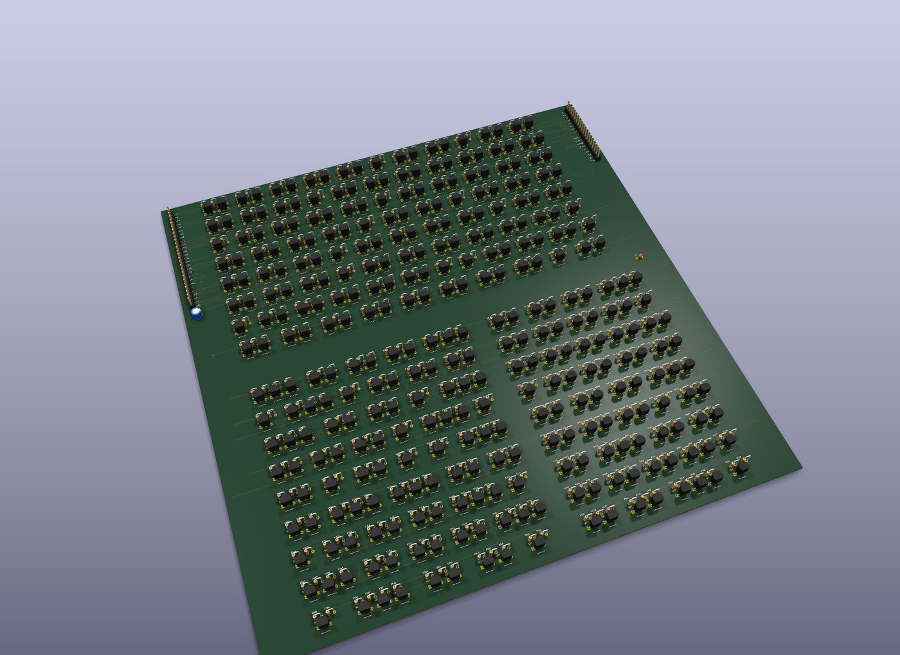
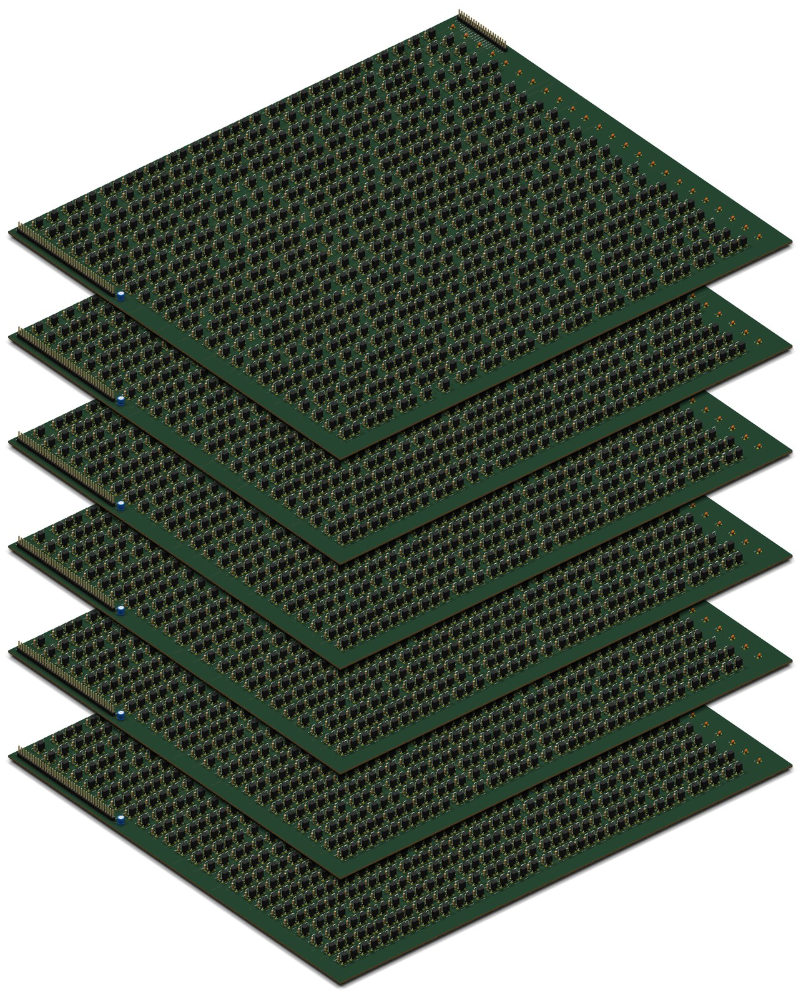

# pcbflow — Verilog para PCB com componentes discretos

[](LICENSE)

O pcbflow transforma um módulo Verilog numa placa de circuito impresso feita só de componentes discretos: transistores MOSFET, transistores bipolares com resistores (lógica RTL) ou relés. Ele sintetiza o circuito com o Yosys, mapeia o resultado para uma biblioteca de portas montadas com esses componentes, confere por simulação que a placa faz o mesmo que o Verilog, posiciona e roteia tudo e entrega um projeto KiCad pronto para revisão e fabricação.

```
Verilog ──Yosys/ABC──▶ células (.lib) ──expansão (.sp)──▶ componentes ──placement──▶ roteamento ──▶ KiCad
                            │                                 │
                            └── simulação gate-level ─────────┴── simulação em nível de componente
```

É um fluxo de projeto de chip (síntese, biblioteca de células, floorplan, placement, roteamento, verificação) aplicado a uma PCB. Serve para construir computadores e circuitos digitais "à moda antiga", com portas lógicas visíveis, a partir de um RTL comum.

<p align="center">
  
</p>

**Exemplo de resultado:** o [`demo_top`](https://github.com/VictorGerin/pcbflow/wiki/Exemplo-completo) (somador de 8 bits, contador e registrador) na família RTL vira a placa acima, de 256 x 258 mm, com 340 transistores BC548 e 518 resistores, 100 % roteada em 4 camadas, com 0 erros no DRC do KiCad, em pouco mais de 1 minuto. Em escala maior, uma ALU de 32 bits na família RTL vira uma placa de 860 x 681 mm com 3 234 transistores BC548 e 4 908 resistores, totalmente roteada em 4 camadas (66 mil trilhas, 6 mil vias), com 0 erros no DRC do KiCad. A geração leva cerca de 17 minutos, com os somadores e os estágios do shifter montados como [macros](https://github.com/VictorGerin/pcbflow/wiki/Módulos-e-macros#macros-fluxo-hierárquico).

**Um computador inteiro:** o [SAP-1](examples/sap1) do Ben Eater, em SystemVerilog, vira uma pilha de 6 placas de 400 x 350 mm (controle, ALU e 4 de RAM) ligadas por um barramento tri-state, com 13 587 componentes, 5 363 deles BC548. Cada placa sai 100 % roteada e com 0 erros no DRC do KiCad, e o testbench roda contra as 6 placas montadas.

<p align="center">
  
</p>

**O que tem:**

- cinco famílias de células incluídas: **CMOS** (2N7002 + BSS84), **RTL** (BC548 + resistores), **CTL** (núcleos toroidais de ferrite + BC548 + resistores), **CDL** (núcleos toroidais de ferrite + diodos 1N4148 + resistores, sem transistores) e **relés** (SPDT de 5 V), com portas, flip-flops e latches; e um formato simples para criar outras;
- verificação de cada célula montada contra a função declarada, e simulação do circuito inteiro em nível de componente com o seu testbench;
- [simulação analógica das células e de circuitos](https://github.com/VictorGerin/pcbflow/wiki/Simulação-analógica-das-células) no ngspice (famílias CMOS, RTL, CTL, CDL e de relés, além do somador `add4` e da máquina de estados [`tanque`](examples/tanque)), nos cantos de pior caso, com netlists, CSVs e gráficos publicados em [`docs/cellsim`](docs/cellsim/rtl) para qualquer pessoa reproduzir;
- fan-out resolvido: células trocadas por variantes mais fortes e árvores de buffers balanceadas nas nets que ainda estouram (com drive em pior caso elétrico na família RTL);
- floorplan com fences, regions, guides e keepouts, editado num [editor visual](https://github.com/VictorGerin/pcbflow/wiki/Editor-visual) no navegador, e [conectores](https://github.com/VictorGerin/pcbflow/wiki/Floorplan#conectores) em qualquer borda com a pinagem escolhida (para casar placas vizinhas);
- placement por anelamento simulado e roteamento por negociação (PathFinder) em grade, compilados com numba;
- fluxo hierárquico com [macros](https://github.com/VictorGerin/pcbflow/wiki/Módulos-e-macros#macros-fluxo-hierárquico): blocos repetidos são montados uma vez e copiados;
- barramentos tri-state (drivers de coletor aberto e a terminação do barramento) e sistemas de várias placas ligadas por um conector comum, conferidos juntos pelo `pcbflow-system` (drive entre placas e simulação do conjunto);
- placas de 4 camadas (VDD e GND em planos) ou de [2 camadas](https://github.com/VictorGerin/pcbflow/wiki/Placa-de-2-camadas);
- projeto KiCad com grupos por módulo, modelos 3D, lista de materiais e DRC.


**Documentação:** o manual completo está na **[Wiki](https://github.com/VictorGerin/pcbflow/wiki)**.

## Instalação

Pré-requisitos: Python ≥ 3.10, [Yosys](https://github.com/YosysHQ/yosys) e [Icarus Verilog](https://github.com/steveicarus/iverilog) no PATH e, para abrir o resultado e rodar o DRC, o [KiCad](https://www.kicad.org/) 8 ou mais novo.

```sh
git clone https://github.com/VictorGerin/pcbflow.git
cd pcbflow
pip install -e ".[fast]"        # [fast] traz o numba, que compila o placement e o roteador
```

Os pacotes do Yosys e do Icarus para cada sistema, a instalação sem clonar e a imagem Docker estão em [Instalação](https://github.com/VictorGerin/pcbflow/wiki/Instalação).

## Uso

```sh
pcbflow --top counter4 --src examples/counter4.v --tb examples/tb_counter4.v   # família CMOS (padrão)
pcbflow --top counter4 --src examples/counter4.v --lib rtl                     # família RTL com BC548
pcbflow --top counter4 --src examples/counter4.v --lib relay --layers 2       # relés, placa de 2 camadas
```

A placa sai em `build/pcb/<top>_<família>[_2l]/`, com o projeto KiCad, a lista de materiais e um `report.md`. O projeto de exemplo com vários módulos e floorplan fica em [`examples/demo`](examples/demo):

```sh
cd examples/demo
pcbflow --top demo_top --lib rtl                      # placa completa
pcbflow-fpedit demo_top.floorplan.json --lib rtl      # abre o floorplan no editor visual
```

O SAP-1 em [`examples/sap1`](examples/sap1) mostra um sistema de várias placas: cada placa é um `pcbflow --top <placa>`, e o `pcbflow-system` confere a pilha montada.

## Documentação

| Página | Assunto |
|---|---|
| [Uso](https://github.com/VictorGerin/pcbflow/wiki/Uso) | opções da linha de comando, `pcbflow.json`, placement reaproveitado, roteamento retomável |
| [Exemplo completo](https://github.com/VictorGerin/pcbflow/wiki/Exemplo-completo) | o `demo_top`, do floorplan à placa montada |
| [Como funciona](https://github.com/VictorGerin/pcbflow/wiki/Como-funciona) | as seis etapas, simulação em nível de componente, placement e roteamento |
| [Bibliotecas de células](https://github.com/VictorGerin/pcbflow/wiki/Bibliotecas-de-células) | formato das famílias, fan-out, verificações, latches, criar uma família nova |
| [Simulação analógica das células](https://github.com/VictorGerin/pcbflow/wiki/Simulação-analógica-das-células) | `pcbflow-cellsim`: células e circuitos (`add4`, [`tanque`](examples/tanque)) no ngspice, atrasos, flip-flops, CSVs e netlists em [`docs/cellsim`](docs/cellsim/rtl) |
| [Saídas e KiCad](https://github.com/VictorGerin/pcbflow/wiki/Saídas-e-KiCad) | arquivos gerados e revisão da placa no KiCad |
| [Módulos e macros](https://github.com/VictorGerin/pcbflow/wiki/Módulos-e-macros) | hierarquia na placa e fluxo hierárquico |
| [Floorplan](https://github.com/VictorGerin/pcbflow/wiki/Floorplan) | fences, regions, guides, keepouts, conectores, densidade |
| [Editor visual](https://github.com/VictorGerin/pcbflow/wiki/Editor-visual) | o `pcbflow-fpedit` |
| [Placa de 2 camadas](https://github.com/VictorGerin/pcbflow/wiki/Placa-de-2-camadas) | alimentação por trilhos |
| [Escala e limitações](https://github.com/VictorGerin/pcbflow/wiki/Escala-e-limitações) | tamanho dos circuitos e o que ainda falta |
| [Desenvolvimento](https://github.com/VictorGerin/pcbflow/wiki/Desenvolvimento) | testes e arquitetura do código |

## Testes

```sh
pip install -e ".[fast,test]"
python -m pytest                  # tudo o que as ferramentas instaladas permitem (~2 min)
python -m pytest -m "not slow"    # só os de unidade (~10 s)
```

Os grupos de testes e o que cada arquivo confere estão em [Desenvolvimento](https://github.com/VictorGerin/pcbflow/wiki/Desenvolvimento).

## Licença

[MIT](LICENSE).
