# Células da família `cdl` no ngspice

Cada célula da família é simulada como circuito de verdade, com o modelo SPICE dos componentes, e não só como chaves ideais. Os resultados de todos os cantos estão em [resultados.md](resultados.md).

## Reproduzir

Cada `<CÉLULA>.cir` é um netlist do ngspice completo: o modelo do transistor, os subcircuitos da célula e da carga, as fontes com os vetores de teste e as medidas. O cabeçalho explica os vetores e o valor esperado de cada medida. É o teste funcional no canto típico.

```sh
ngspice -b AND2.cir      # imprime as medidas e grava AND2.dat com as formas de onda
```

Para rodar todos os cantos e refazer estes arquivos: `fr4lane-cellsim --lib cdl --export docs/cellsim/cdl`.

## Células

### AND2

E de 2 entradas CDL por coincidência de corrente em 1 núcleo (1 núcleo toroidal + 2 diodos + 4 resistores)

[AND2.cir](AND2.cir) — passa no canto típico

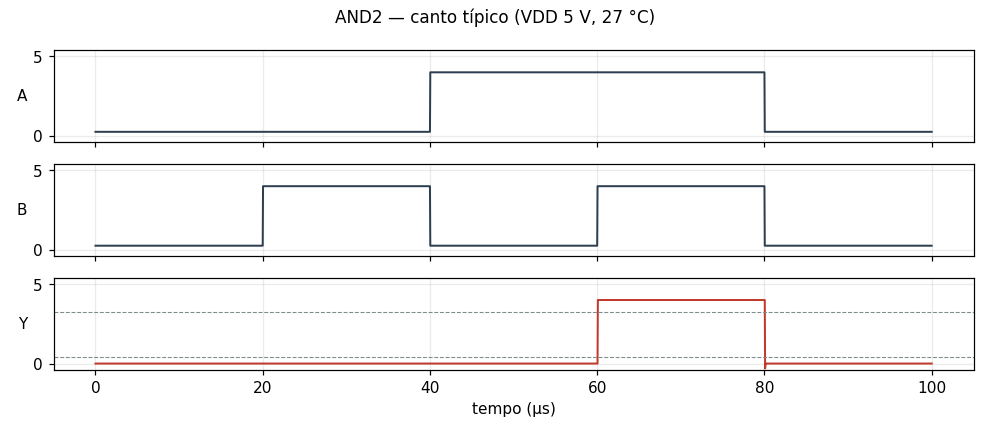

### BUF

buffer CDL em um único núcleo (1 núcleo toroidal + 1 diodo + 2 resistores)

[BUF.cir](BUF.cir) — passa no canto típico

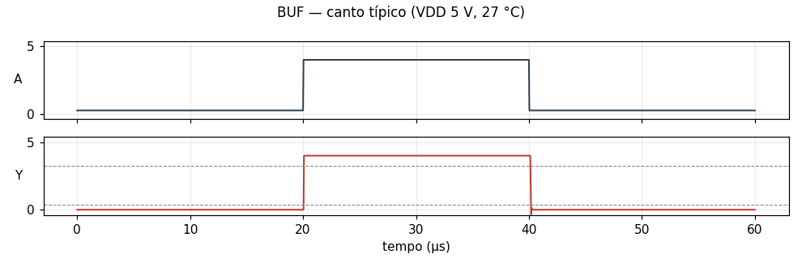

### DFF

flip-flop D de borda de subida CDL (5 NOR2 + 1 NOR3 + 1 INV; 7 núcleos toroidais)

[DFF.cir](DFF.cir) — passa no canto típico

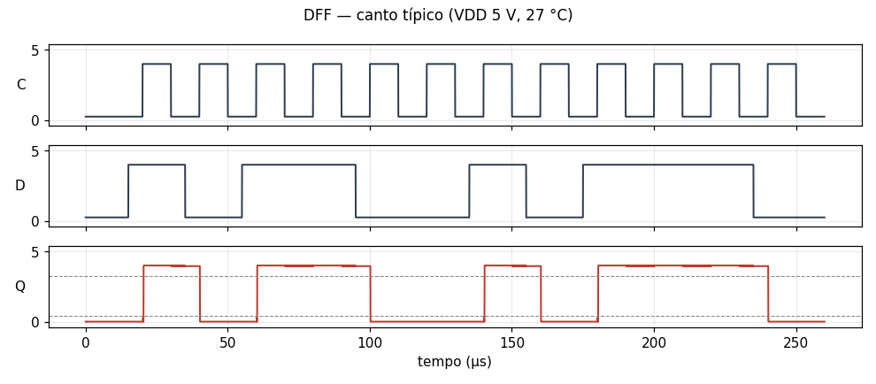

### DFFR

flip-flop D com clear ativo baixo CDL (3 NOR2 + 3 NOR3 + 2 INV; 8 núcleos toroidais)

[DFFR.cir](DFFR.cir) — passa no canto típico

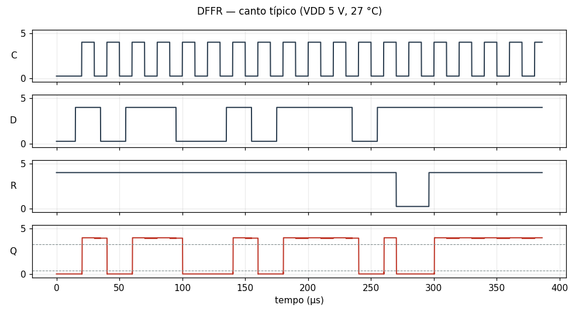

### DLAT

latch D transparente CDL (4 NOR2 + 1 INV; 5 núcleos toroidais)

[DLAT.cir](DLAT.cir) — passa no canto típico

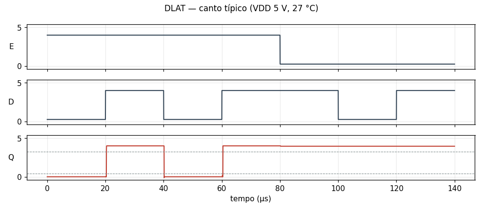

### INV

inversor CDL por inibição magnética (1 núcleo toroidal + 1 diodo + 3 resistores)

[INV.cir](INV.cir) — passa no canto típico

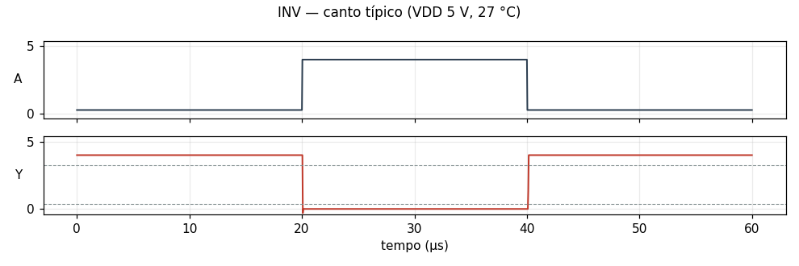

### NAND2

NAND de 2 entradas CDL (AND2 + INV; 2 núcleos toroidais)

[NAND2.cir](NAND2.cir) — passa no canto típico

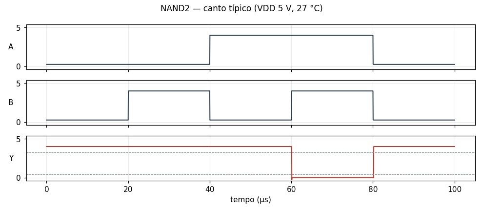

### NOR2

NOR de 2 entradas CDL por inibição magnética (1 núcleo toroidal + 2 diodos + 3 resistores)

[NOR2.cir](NOR2.cir) — passa no canto típico

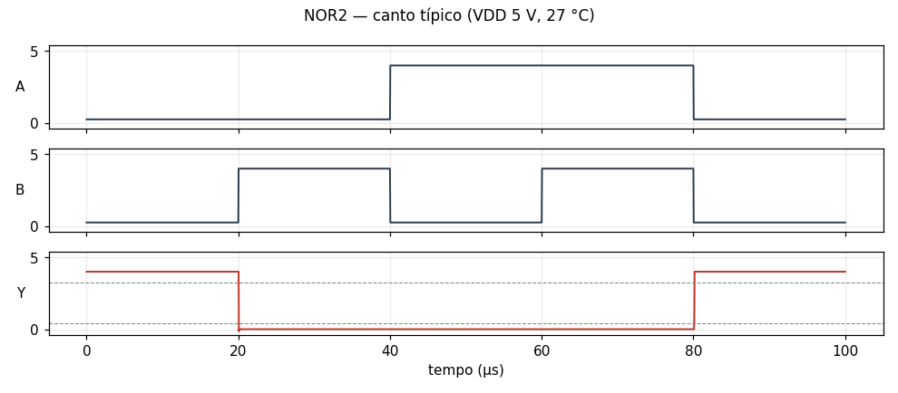

### NOR3

NOR de 3 entradas CDL em um único núcleo (1 núcleo toroidal + 3 diodos + 3 resistores)

[NOR3.cir](NOR3.cir) — passa no canto típico

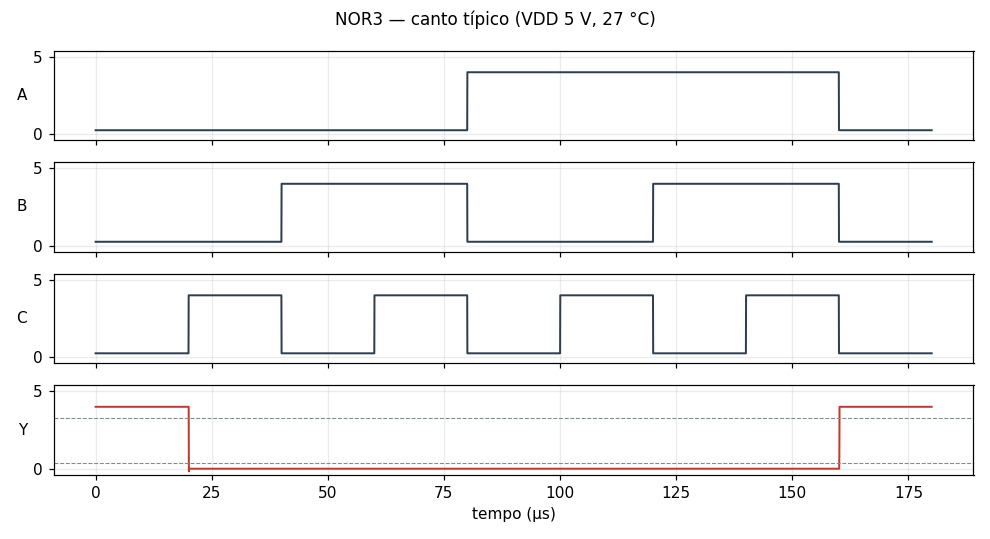

### OR2

OU de 2 entradas CDL em 1 núcleo (1 núcleo toroidal + 2 diodos + 2 resistores)

[OR2.cir](OR2.cir) — passa no canto típico

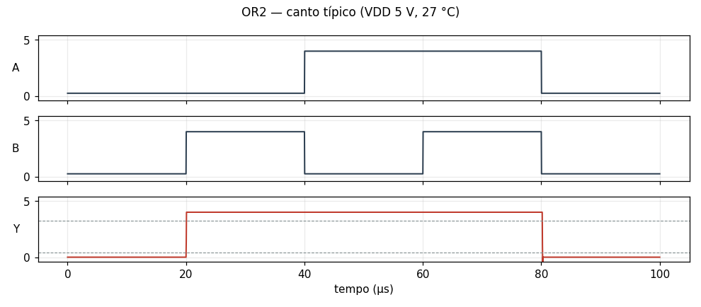

### XNOR2

XNOR de 2 entradas CDL em 3 núcleos (AND2 + NOR2 + OR2)

[XNOR2.cir](XNOR2.cir) — passa no canto típico

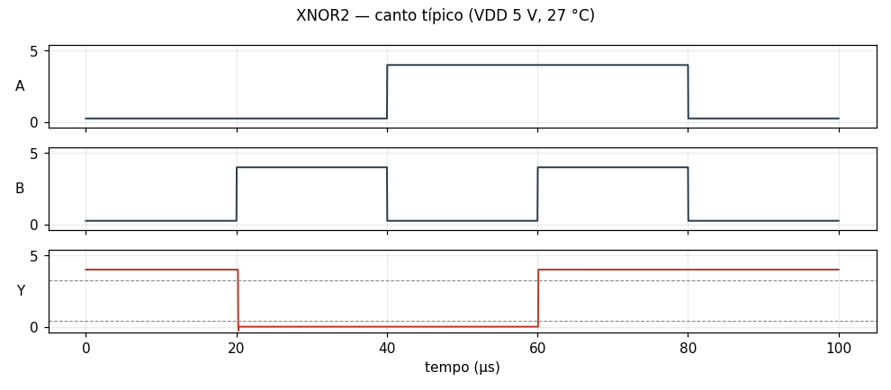

### XOR2

XOR de 2 entradas CDL em 4 núcleos (OR2 + NAND2 + AND2)

[XOR2.cir](XOR2.cir) — passa no canto típico

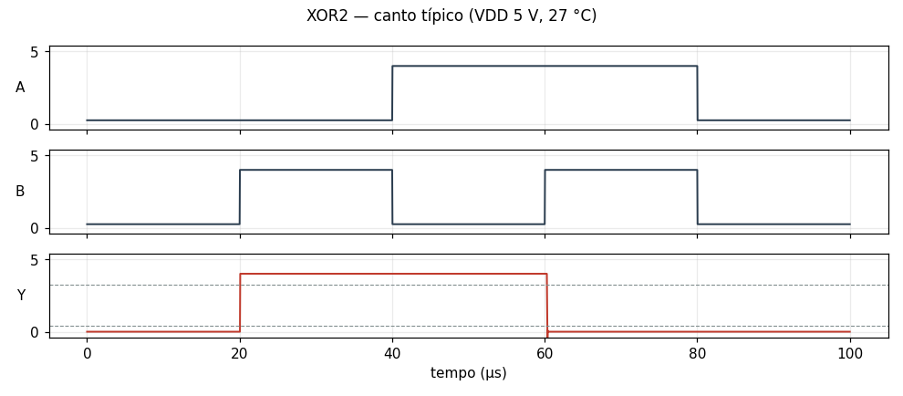

## Circuito tanque

Um circuito inteiro, sintetizado pelo fr4lane: 15 células, 201 componentes e 17 vetores. Resultados e gráfico em [tanque.md](tanque.md); dados em [tanque.csv](tanque.csv); netlist em [tanque.cir](tanque.cir).

