# Células da família `cmos` no ngspice

Cada célula da família é simulada como circuito de verdade, com o modelo SPICE dos componentes, e não só como chaves ideais. Os resultados de todos os cantos estão em [resultados.md](resultados.md).

## Reproduzir

Cada `<CÉLULA>.cir` é um netlist do ngspice completo: o modelo do transistor, os subcircuitos da célula e da carga, as fontes com os vetores de teste e as medidas. O cabeçalho explica os vetores e o valor esperado de cada medida. É o teste funcional no canto típico.

```sh
ngspice -b AOI21.cir      # imprime as medidas e grava AOI21.dat com as formas de onda
```

Para rodar todos os cantos e refazer estes arquivos: `pcbflow-cellsim --lib cmos --export docs/cellsim/cmos`.

## Células

### AOI21

AND-OR-INVERT: Y = !((A&B)|C)

[AOI21.cir](AOI21.cir) — passa no canto típico

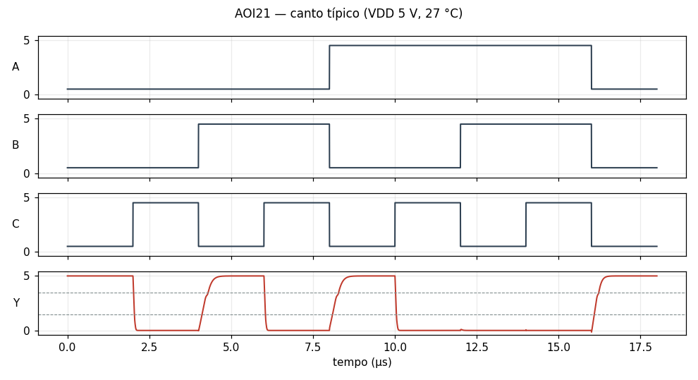

### BUF

buffer (dois inversores)

[BUF.cir](BUF.cir) — passa no canto típico

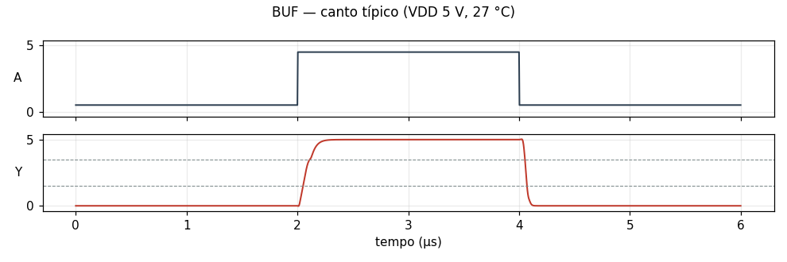

### DFF

flip-flop D, borda de subida (6 NANDs)

[DFF.cir](DFF.cir) — passa no canto típico

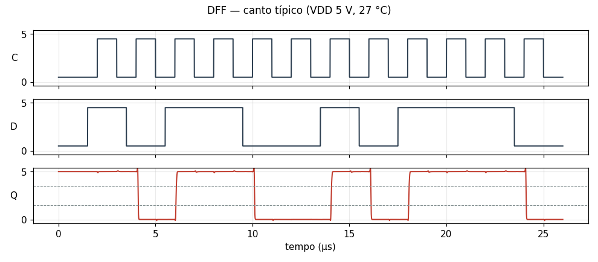

### DFFR

flip-flop D, borda de subida, clear assíncrono ativo baixo (estilo 7474)

[DFFR.cir](DFFR.cir) — passa no canto típico

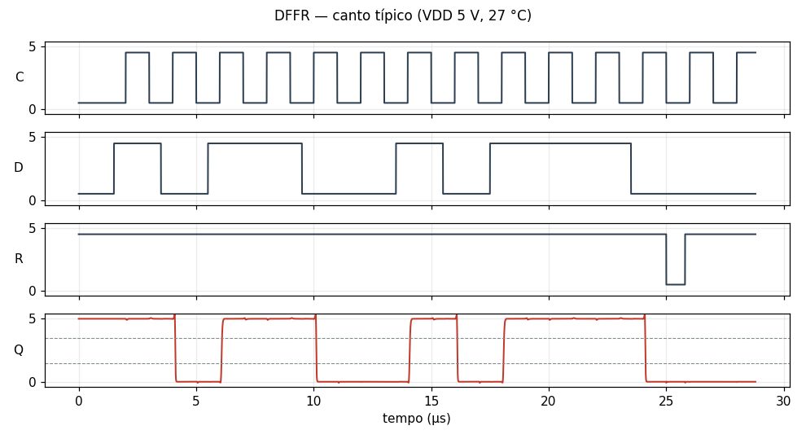

### DLAT

latch D transparente com E = 1 (latch SR de NANDs com entrada controlada; 4 NANDs)

[DLAT.cir](DLAT.cir) — passa no canto típico

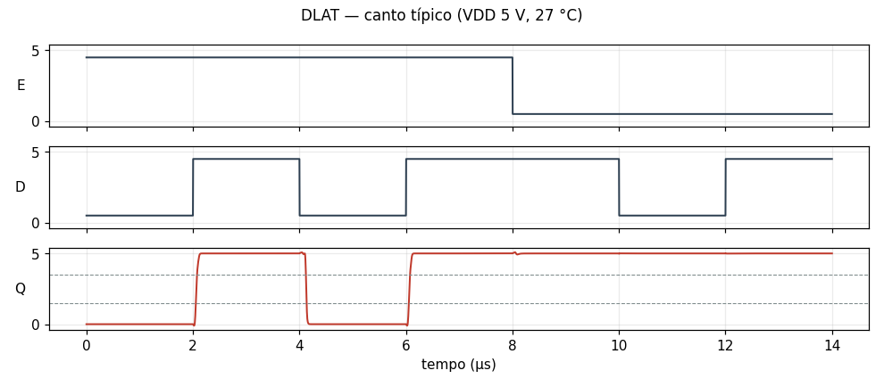

### INV

inversor CMOS

[INV.cir](INV.cir) — passa no canto típico

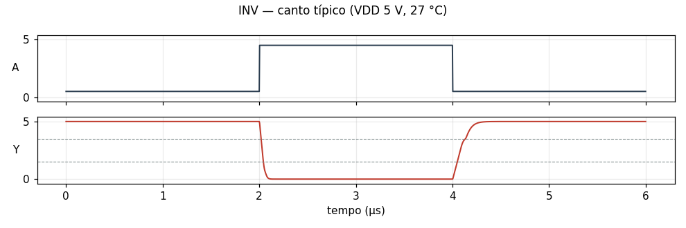

### NAND2

NAND de 2 entradas, CMOS estático

[NAND2.cir](NAND2.cir) — passa no canto típico

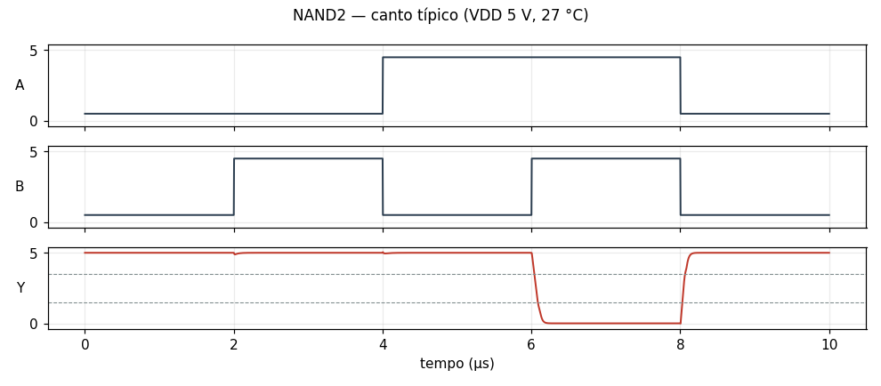

### NAND3

NAND de 3 entradas, CMOS estático

[NAND3.cir](NAND3.cir) — passa no canto típico

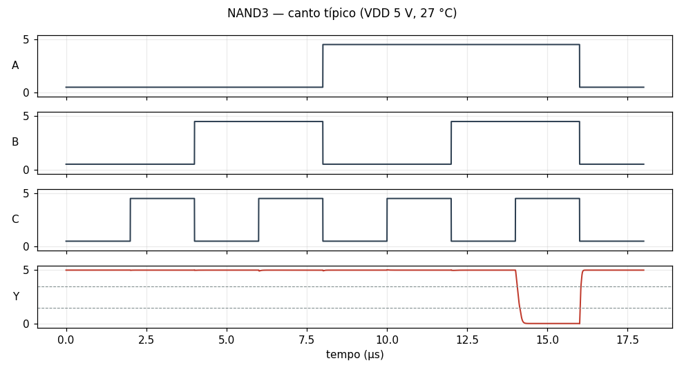

### NOR2

NOR de 2 entradas, CMOS estático

[NOR2.cir](NOR2.cir) — passa no canto típico

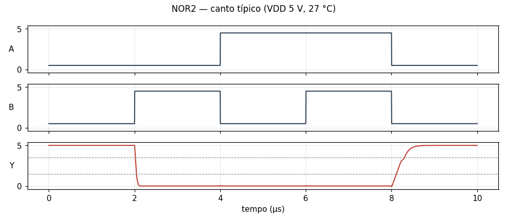

### NOR3

NOR de 3 entradas, CMOS estático

[NOR3.cir](NOR3.cir) — passa no canto típico

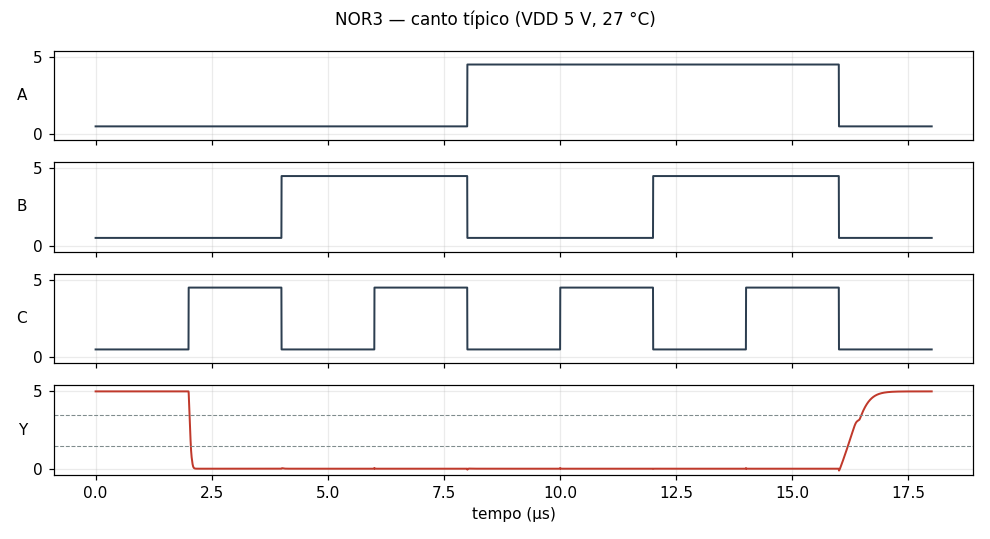

### OAI21

OR-AND-INVERT: Y = !((A|B)&C)

[OAI21.cir](OAI21.cir) — passa no canto típico

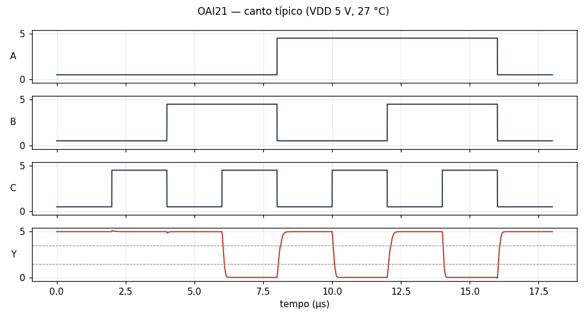

## Circuito add4

Um circuito inteiro, sintetizado pelo pcbflow: 36 células, 144 componentes e 512 vetores. Resultados e gráfico em [add4.md](add4.md); netlist em [add4.cir](add4.cir).

