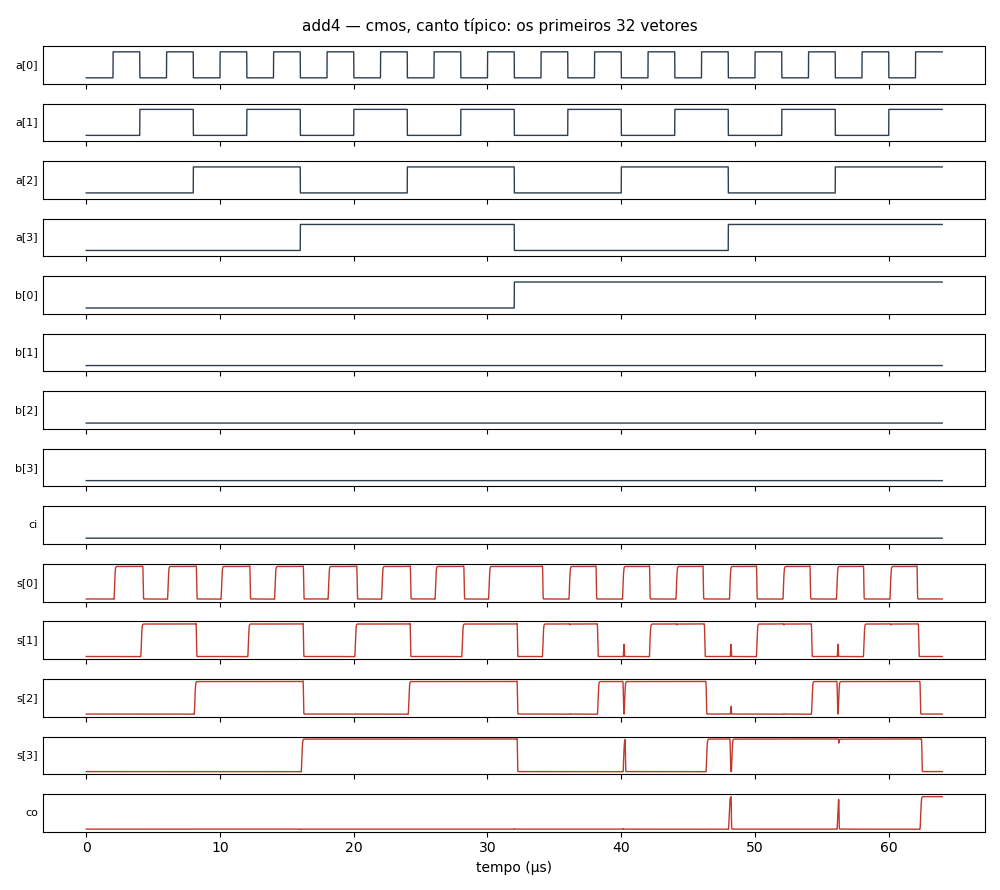

# Circuito `add4` na família `cmos` (ngspice)

36 células, 144 componentes, 512 vetores (todas as combinações das entradas, simuladas em lotes de 64). Cada vetor é conferido contra a lógica do netlist; o caminho crítico é o último cruzamento de uma saída depois da mudança das entradas. O netlist publicado tem os primeiros 64 vetores.

| Canto | Resultado | Caminho crítico |
|---|---|---|
| típico | OK | 519 ns (s[3] no vetor 331) |
| lento | OK | 788 ns (s[3] no vetor 391) |
| rápido | OK | 223 ns (s[3] no vetor 421) |

Reproduzir (canto típico): `ngspice -b add4.cir`

