# Células da família `ctl` no ngspice

Cada célula da família é simulada como circuito de verdade, com o modelo SPICE dos componentes, e não só como chaves ideais. Os resultados de todos os cantos estão em [resultados.md](resultados.md).

## Reproduzir

Cada `<CÉLULA>.cir` é um netlist do ngspice completo: o modelo do transistor, os subcircuitos da célula e da carga, as fontes com os vetores de teste e as medidas. O cabeçalho explica os vetores e o valor esperado de cada medida. É o teste funcional no canto típico.

```sh
ngspice -b AND2.cir      # imprime as medidas e grava AND2.dat com as formas de onda
```

Para rodar todos os cantos e refazer estes arquivos: `fr4lane-cellsim --lib ctl --export docs/cellsim/ctl`.

## Células

### AND2

AND de 2 entradas CTL (NAND2 + inversor)

[AND2.cir](AND2.cir) — passa no canto típico

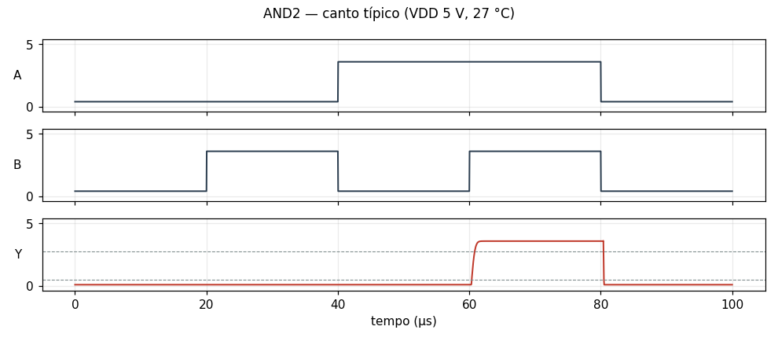

### BUF

buffer CTL (dois inversores)

[BUF.cir](BUF.cir) — passa no canto típico

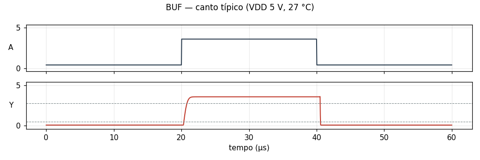

### DFF

flip-flop D, borda de subida (portas NOR2 + INV em lógica CTL)

[DFF.cir](DFF.cir) — passa no canto típico

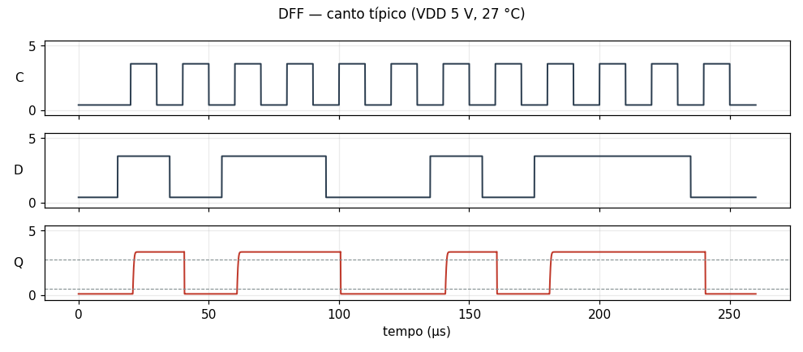

### DFFR

flip-flop D, borda de subida, clear assíncrono ativo baixo (lógica CTL)

[DFFR.cir](DFFR.cir) — passa no canto típico

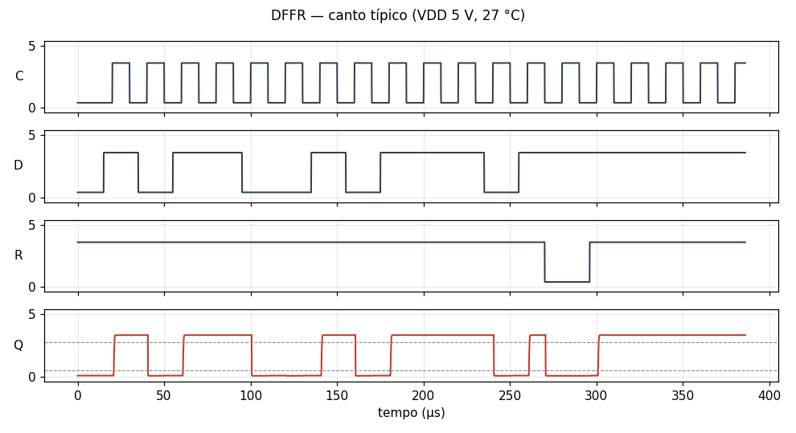

### DLAT

latch D transparente com E = 1 (4 NOR2 CTL + inversor)

[DLAT.cir](DLAT.cir) — passa no canto típico

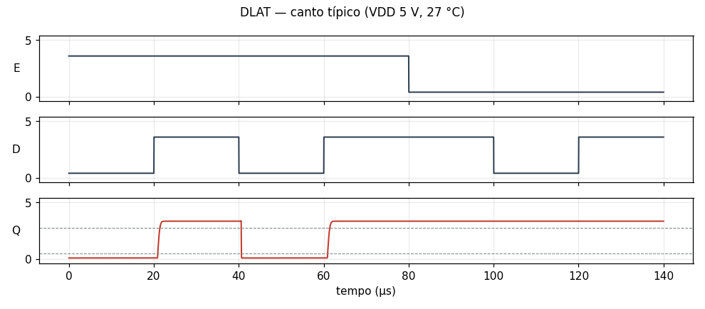

### INV

inversor CTL (1 núcleo toroidal + 1 NPN + 2 resistores)

[INV.cir](INV.cir) — passa no canto típico

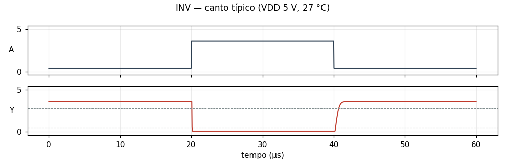

### NAND2

NAND de 2 entradas CTL por coincidência de corrente (1 núcleo + 1 NPN)

[NAND2.cir](NAND2.cir) — passa no canto típico

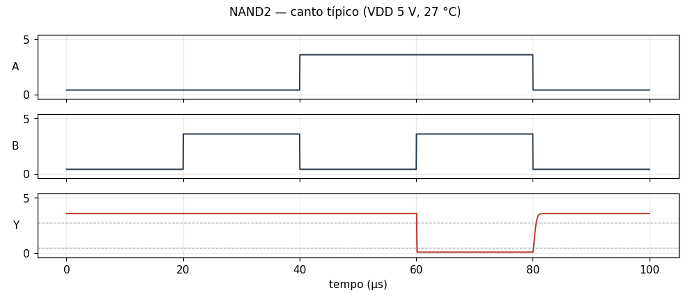

### NOR2

NOR de 2 entradas CTL (soma de fluxo em 1 núcleo + 1 NPN)

[NOR2.cir](NOR2.cir) — passa no canto típico

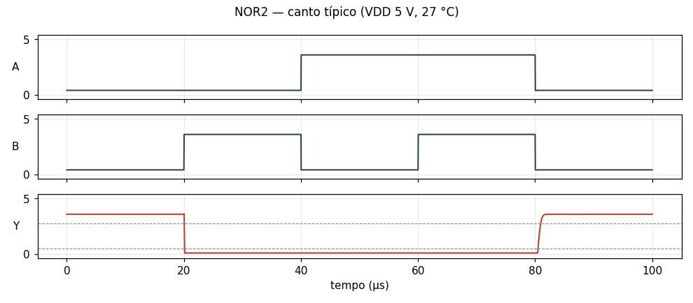

### NOR3

NOR de 3 entradas CTL (2 núcleos toroidais + 1 NPN)

[NOR3.cir](NOR3.cir) — passa no canto típico

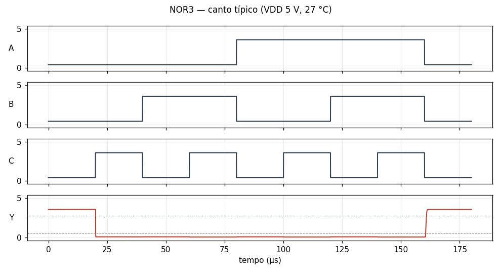

### OR2

OR de 2 entradas CTL (NOR2 + inversor)

[OR2.cir](OR2.cir) — passa no canto típico

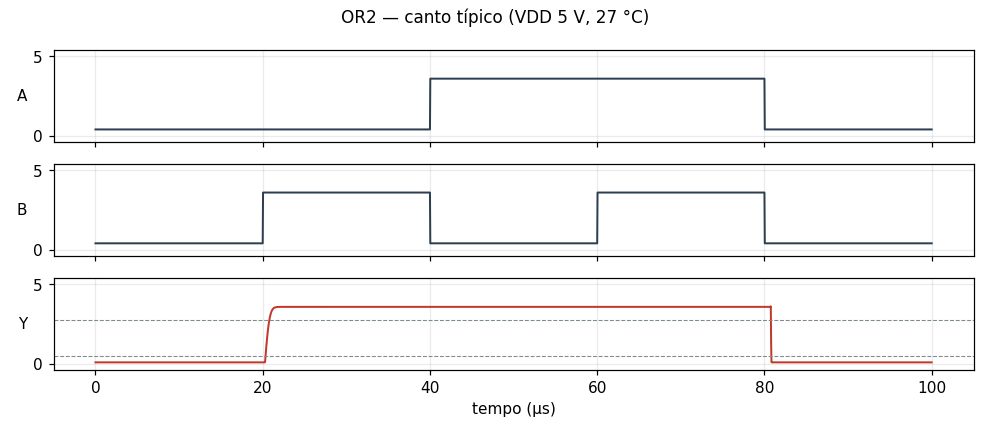

### XNOR2

XNOR de 2 entradas CTL

[XNOR2.cir](XNOR2.cir) — passa no canto típico

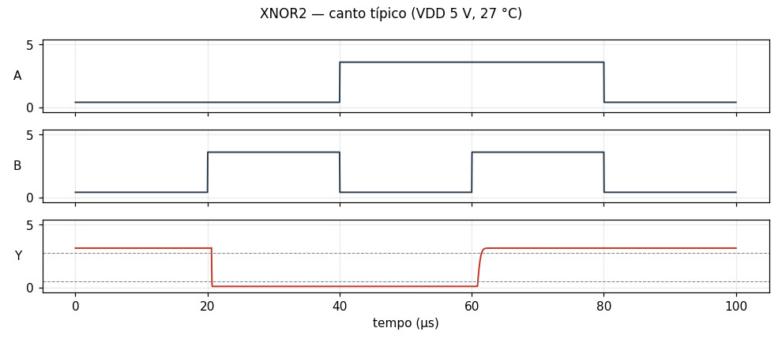

### XOR2

XOR de 2 entradas CTL (XNOR2 por inibição cruzada + inversor)

[XOR2.cir](XOR2.cir) — passa no canto típico

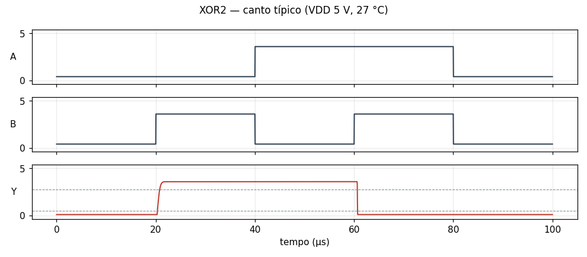

## Circuito tanque

Um circuito inteiro, sintetizado pelo fr4lane: 17 células, 201 componentes e 17 vetores. Resultados e gráfico em [tanque.md](tanque.md); dados em [tanque.csv](tanque.csv); netlist em [tanque.cir](tanque.cir).

