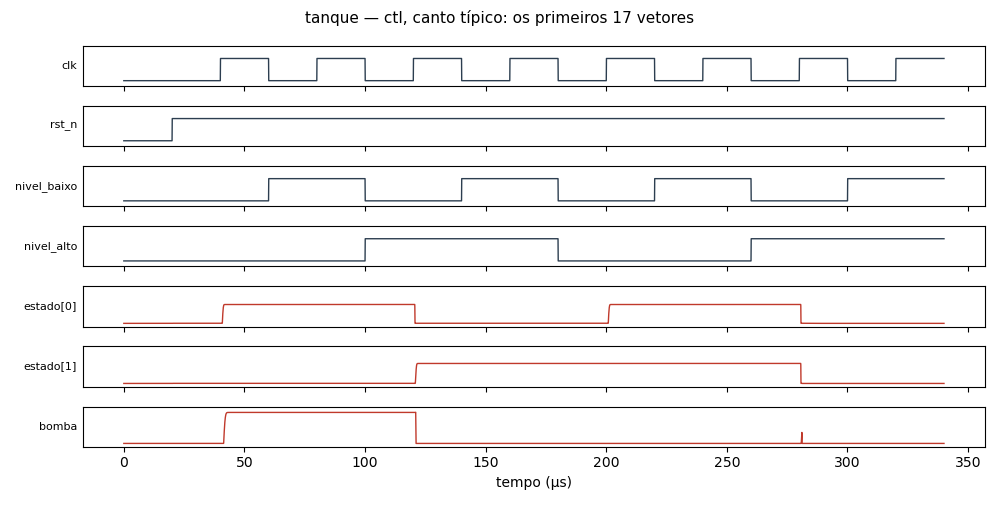

# Circuito `tanque` na família `ctl` (ngspice)

17 células, 201 componentes, 17 vetores (todas as combinações das entradas, simuladas em lotes de 64). Cada vetor é conferido contra a lógica do netlist; o caminho crítico é o último cruzamento de uma saída depois da mudança das entradas. O netlist publicado tem os primeiros 17 vetores.

| Canto | Resultado | Sem convergir | Caminho crítico |
|---|---|---:|---|
| típico | OK | — | 1.59 µs (bomba no vetor 2) |
| lento | OK | — | 1.36 µs (bomba no vetor 2) |
| rápido | OK | — | 1.97 µs (bomba no vetor 2) |
| quente | OK | — | 1.59 µs (bomba no vetor 2) |

Dados completos de todos os vetores e cantos em [tanque.csv](tanque.csv). Reproduzir (canto típico): `ngspice -b tanque.cir`

