# Células da família `relay` no ngspice

Cada célula da família é simulada como circuito de verdade, com o modelo SPICE dos componentes, e não só como chaves ideais. Os resultados de todos os cantos estão em [resultados.md](resultados.md).

## Reproduzir

Cada `<CÉLULA>.cir` é um netlist do ngspice completo: o modelo do transistor, os subcircuitos da célula e da carga, as fontes com os vetores de teste e as medidas. O cabeçalho explica os vetores e o valor esperado de cada medida. É o teste funcional no canto típico.

```sh
ngspice -b AND2.cir      # imprime as medidas e grava AND2.dat com as formas de onda
```

Para rodar todos os cantos e refazer estes arquivos: `pcbflow-cellsim --lib relay --export C:/Users/victo/Documents/pcbflow/docs/cellsim/relay`.

## Células

### AND2

AND: K1 gera A; K2 passa A (B energizado) ou põe GND

[AND2.cir](AND2.cir) — passa no canto típico

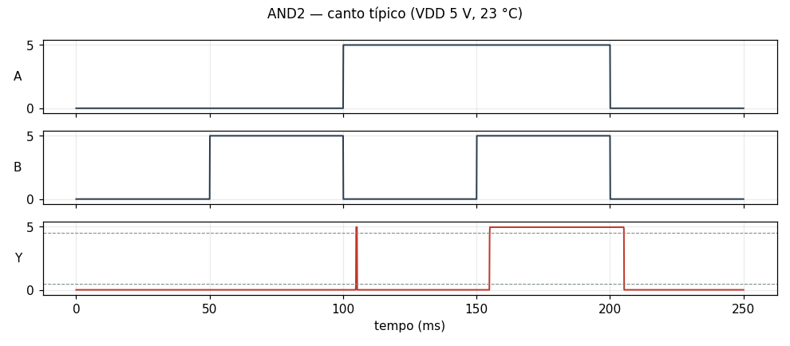

### BUF

buffer: o contato liga a saída ao VDD (energizado) ou ao GND

[BUF.cir](BUF.cir) — passa no canto típico

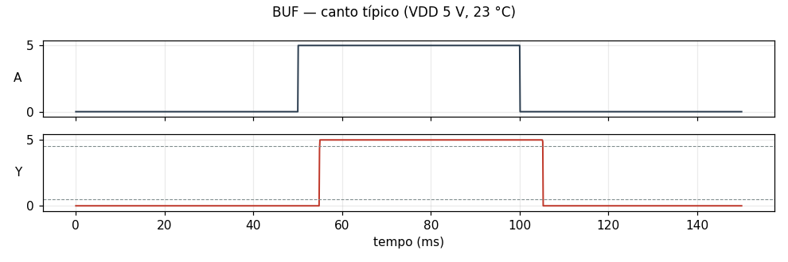

### DFF

flip-flop D, borda de subida: mestre (transparente com C=0) e escravo (com C=1), cada um com um relé de seleção e um relé autotravado

[DFF.cir](DFF.cir) — passa no canto típico

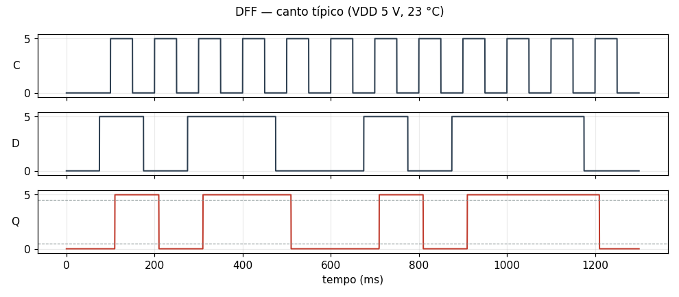

### DFFR

flip-flop D, borda de subida, clear assíncrono ativo baixo: como o DFF, com K5/K6 cortando as bobinas do mestre e do escravo enquanto R = 0

[DFFR.cir](DFFR.cir) — passa no canto típico

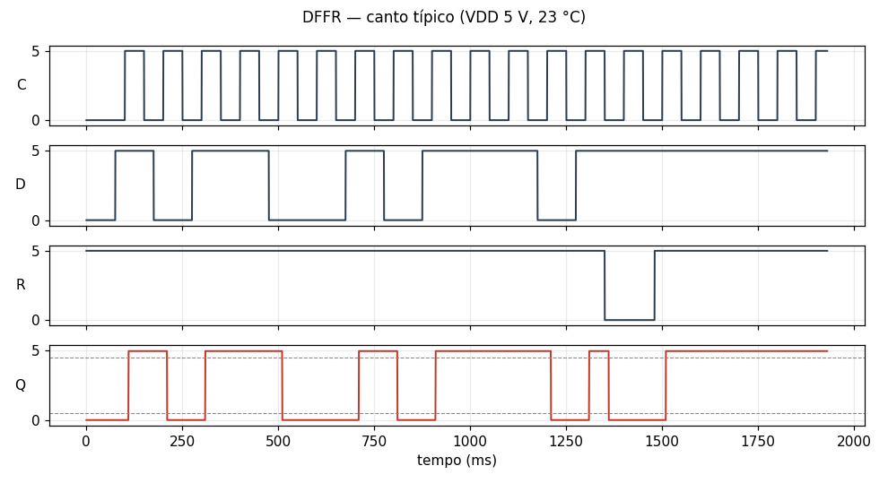

### DLAT

latch D transparente com E = 1: K1 liga a bobina de K2 a D (E energizado) ou à própria saída (E solto), e K2 se autotrava

[DLAT.cir](DLAT.cir) — passa no canto típico

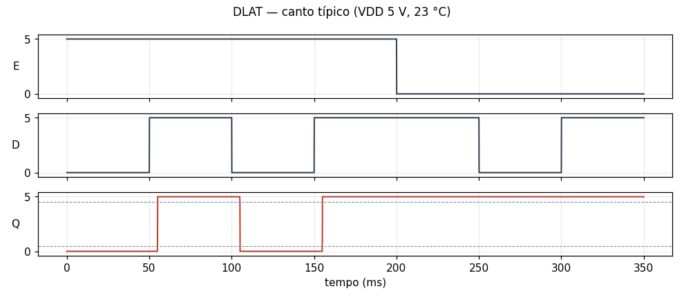

### INV

inversor: o contato liga a saída ao GND (energizado) ou ao VDD

[INV.cir](INV.cir) — passa no canto típico

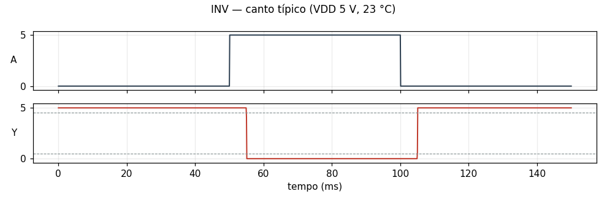

### MUX2

multiplexador: o contato de S comuta a saída entre A (solto) e B (energizado)

[MUX2.cir](MUX2.cir) — passa no canto típico

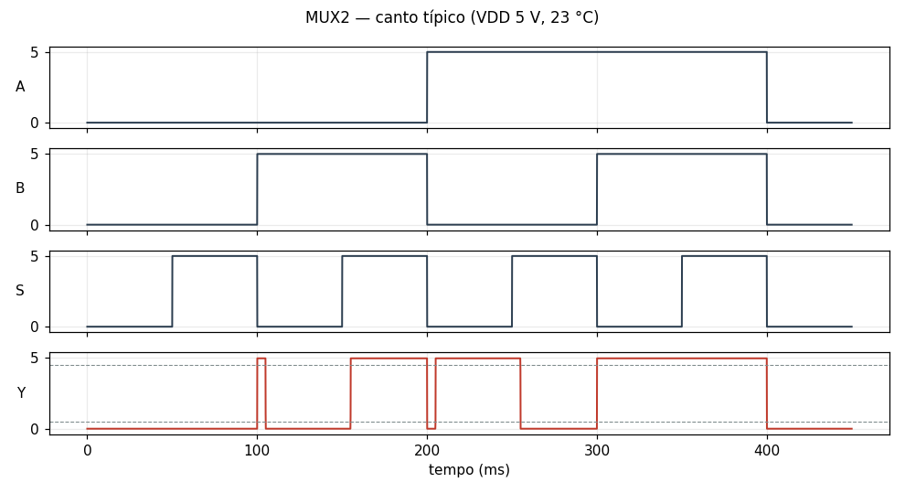

### NAND2

NAND: K1 gera !A; K2 passa !A (B energizado) ou põe VDD

[NAND2.cir](NAND2.cir) — passa no canto típico

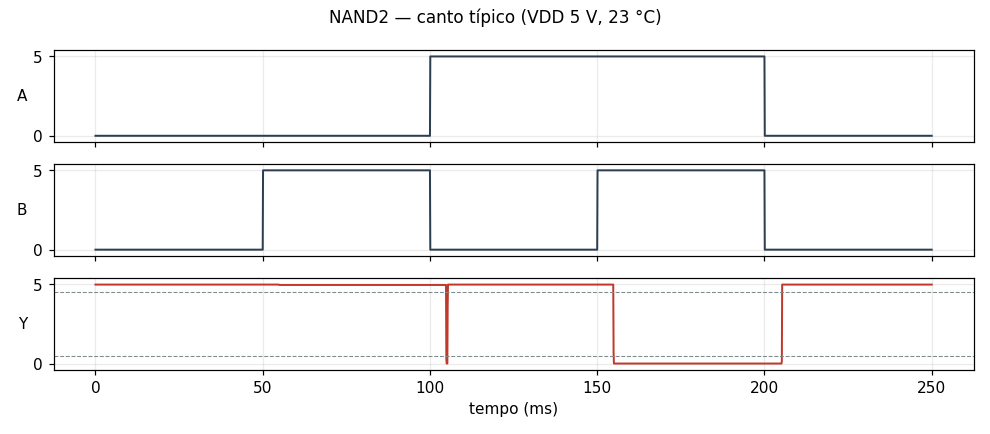

### NOR2

NOR: K1 gera !A; K2 põe GND (B energizado) ou passa !A

[NOR2.cir](NOR2.cir) — passa no canto típico

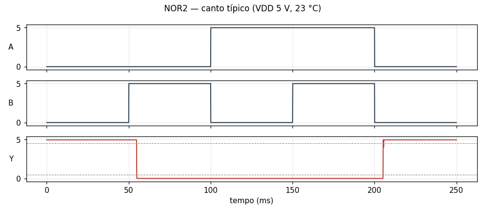

### OR2

OR: K1 gera A; K2 põe VDD (B energizado) ou passa A

[OR2.cir](OR2.cir) — passa no canto típico

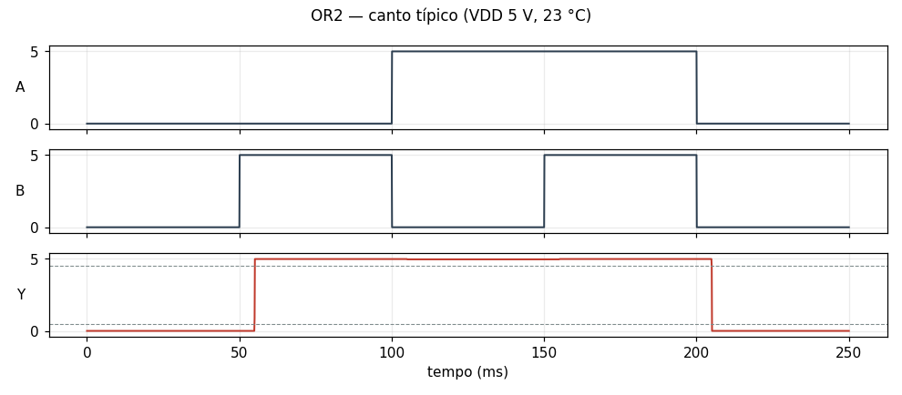

### XNOR2

XNOR: K1 gera !A; K2 escolhe A (B energizado) ou !A

[XNOR2.cir](XNOR2.cir) — passa no canto típico

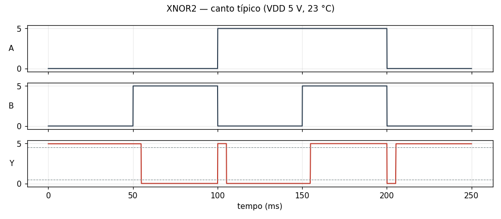

### XOR2

XOR: K1 gera !A; K2 escolhe !A (B energizado) ou A

[XOR2.cir](XOR2.cir) — passa no canto típico

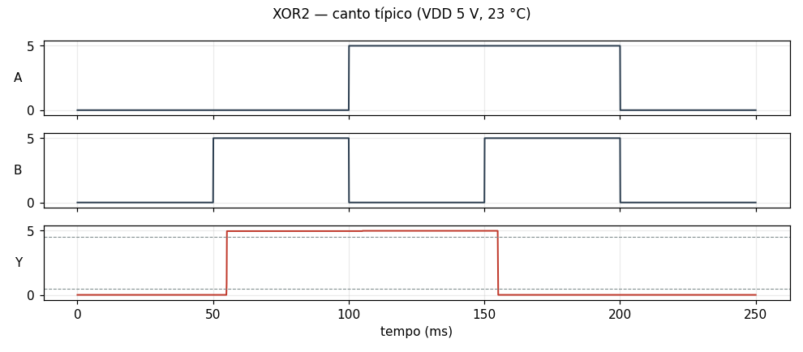

## Circuito add4

Um circuito inteiro, sintetizado pelo pcbflow: 20 células, 80 componentes e 512 vetores. Resultados e gráfico em [add4.md](add4.md); dados em [add4.csv](add4.csv); netlist em [add4.cir](add4.cir).

## Circuito tanque

Um circuito inteiro, sintetizado pelo pcbflow: 15 células, 64 componentes e 17 vetores. Resultados e gráfico em [tanque.md](tanque.md); dados em [tanque.csv](tanque.csv); netlist em [tanque.cir](tanque.cir).

