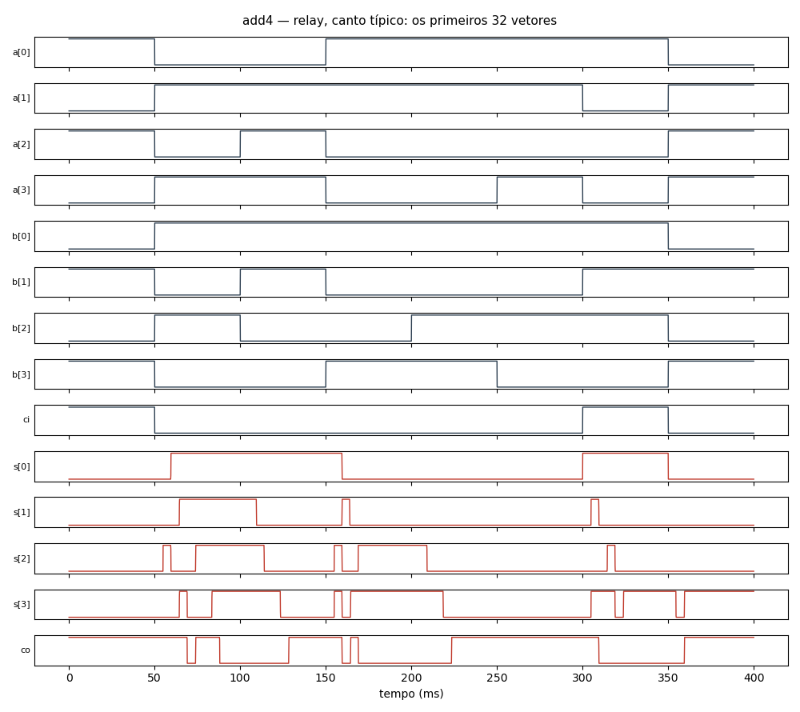

# Circuito `add4` na família `relay` (ngspice)

20 células, 80 componentes, 512 vetores (todas as combinações das entradas, simuladas em lotes de 8). Cada vetor é conferido contra a lógica do netlist; o caminho crítico é o último cruzamento de uma saída depois da mudança das entradas. O netlist publicado tem os primeiros 8 vetores.

| Canto | Resultado | Sem convergir | Caminho crítico |
|---|---|---:|---|
| típico | OK | — | 43 ms (co no vetor 315) |
| lento | OK | — | 43.9 ms (co no vetor 315) |
| quente | OK | — | 44.9 ms (co no vetor 315) |
| rápido | OK | — | 43.2 ms (co no vetor 315) |

Dados completos de todos os vetores e cantos em [add4.csv](add4.csv). Reproduzir (canto típico): `ngspice -b add4.cir`

