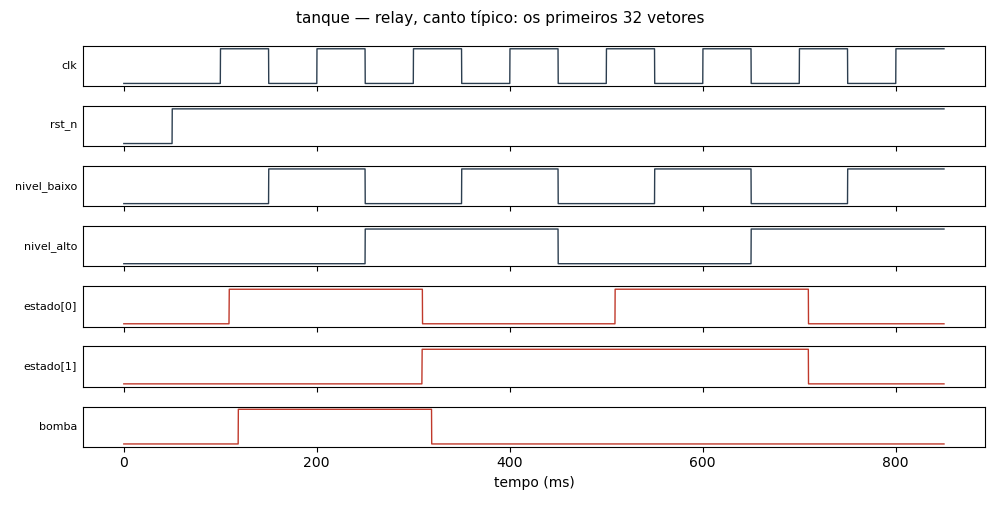

# Circuito `tanque` na família `relay` (ngspice)

15 células, 64 componentes, 17 vetores (todas as combinações das entradas, simuladas em lotes de 8). Cada vetor é conferido contra a lógica do netlist; o caminho crítico é o último cruzamento de uma saída depois da mudança das entradas. O netlist publicado tem os primeiros 8 vetores.

| Canto | Resultado | Sem convergir | Caminho crítico |
|---|---|---:|---|
| típico | OK | — | 18.9 ms (bomba no vetor 6) |
| lento | OK | — | 19.3 ms (bomba no vetor 6) |
| quente | OK | — | 20.1 ms (bomba no vetor 2) |
| rápido | OK | — | 18.8 ms (bomba no vetor 6) |

Dados completos de todos os vetores e cantos em [tanque.csv](tanque.csv). Reproduzir (canto típico): `ngspice -b tanque.cir`

