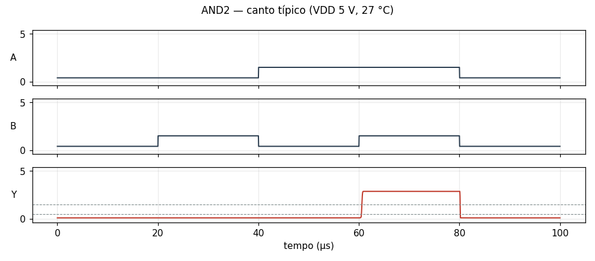
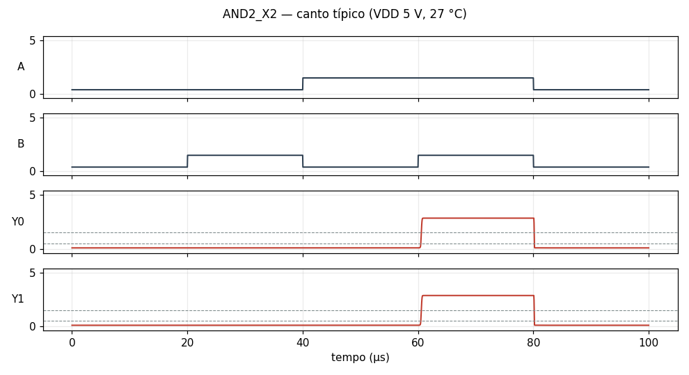
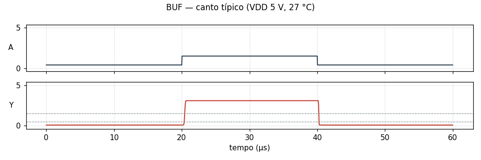
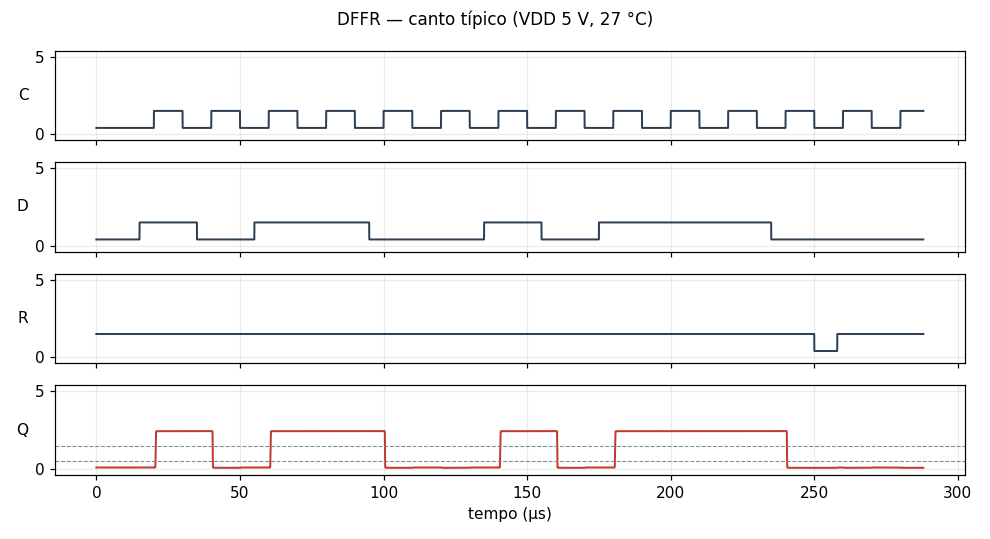
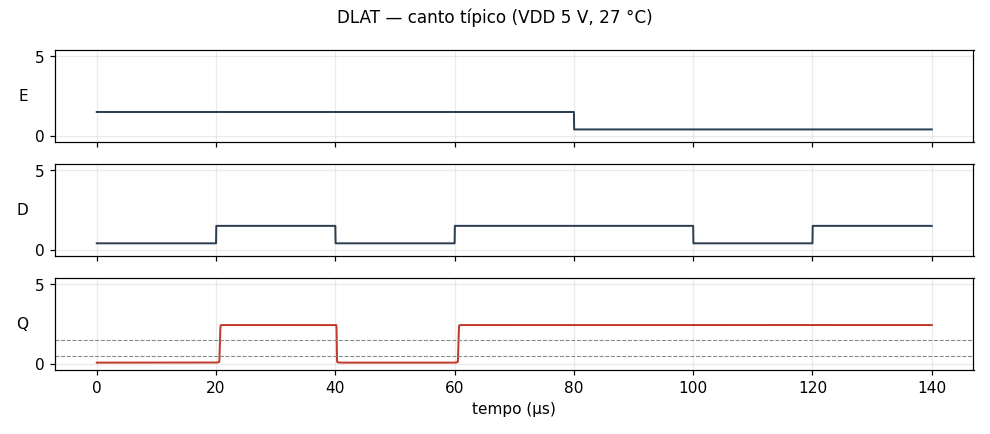
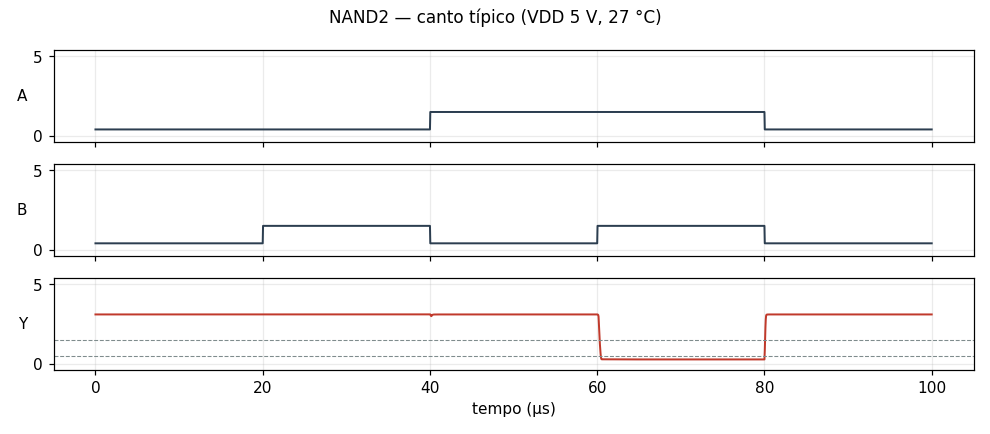
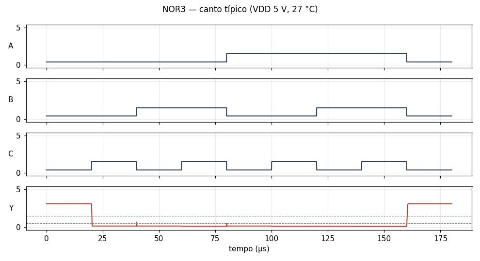
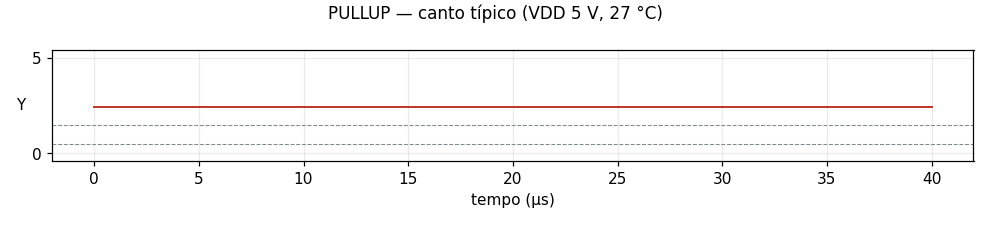
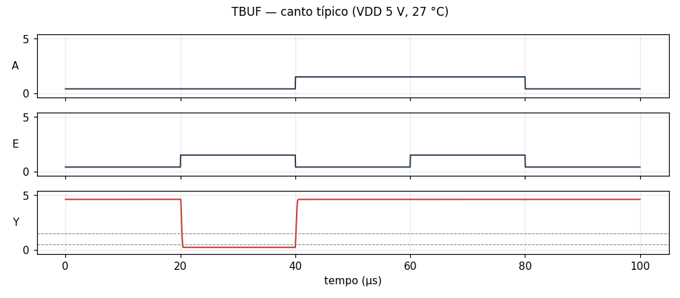

# Células da família `rtl` no ngspice

Cada célula da família é simulada como circuito de verdade, com o modelo SPICE dos componentes, e não só como chaves ideais. Os resultados de todos os cantos estão em [resultados.md](resultados.md).

## Reproduzir

Cada `<CÉLULA>.cir` é um netlist do ngspice completo: o modelo do transistor, os subcircuitos da célula e da carga, as fontes com os vetores de teste e as medidas. O cabeçalho explica os vetores e o valor esperado de cada medida. É o teste funcional no canto típico.

```sh
ngspice -b AND2.cir      # imprime as medidas e grava AND2.dat com as formas de onda
```

Para rodar todos os cantos e refazer estes arquivos: `pcbflow-cellsim --lib rtl --export docs/cellsim/rtl`.

## Células

### AND2

AND de 2 entradas RTL (NAND2 + inversor), fan-out 1–10

[AND2.cir](AND2.cir) — passa no canto típico



### AND2_X2

AND de 2 entradas com 2 saídas (NAND2 + 2 inversores), fan-out 10–20 (até 10 por saída)

[AND2_X2.cir](AND2_X2.cir) — passa no canto típico



### BUF

buffer (dois inversores)

[BUF.cir](BUF.cir) — passa no canto típico



### DFF

flip-flop D, borda de subida (6 NORs + inversor de clock)

[DFF.cir](DFF.cir) — passa no canto típico


### DFFR

flip-flop D, borda de subida, clear assíncrono ativo baixo

[DFFR.cir](DFFR.cir) — passa no canto típico



### DLAT

latch D transparente com E = 1 (latch SR de NORs com entrada controlada; 4 NORs + inversor)

[DLAT.cir](DLAT.cir) — passa no canto típico



### INV

inversor RTL (1 NPN + 2 resistores)

[INV.cir](INV.cir) — passa no canto típico


### NAND2

NAND de 2 entradas RTL (NPNs em série)

[NAND2.cir](NAND2.cir) — passa no canto típico



### NOR2

NOR de 2 entradas RTL

[NOR2.cir](NOR2.cir) — passa no canto típico


### NOR3

NOR de 3 entradas RTL

[NOR3.cir](NOR3.cir) — passa no canto típico



### PULLUP

terminação de barramento: pull-up de 1k para o VDD, uma por linha

[PULLUP.cir](PULLUP.cir) — passa no canto típico



### TBUF

driver de barramento de coletor aberto: inversor de A + dois NPNs em série (E e !A), sem pull-up

[TBUF.cir](TBUF.cir) — passa no canto típico



