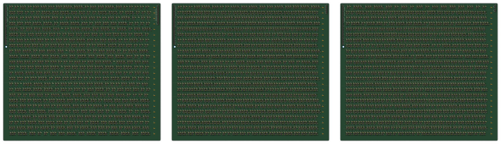
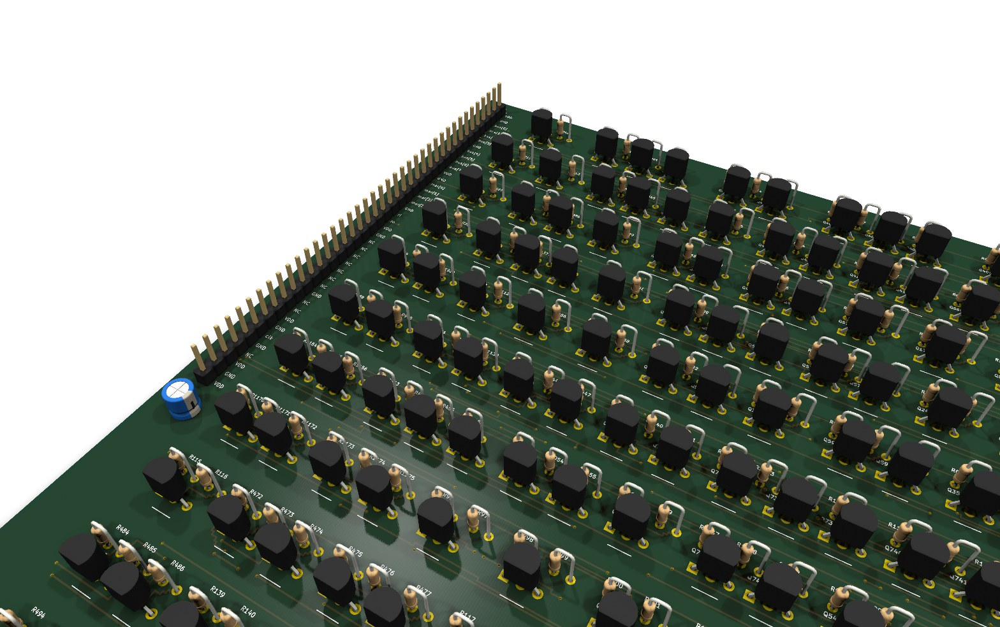

# SAP-1 em componentes discretos

O computador de 8 bits do Ben Eater, o SAP-1 ("Simple As Possible") do livro *Digital Computer Electronics* (Malvino), escrito em SystemVerilog e gerado pelo fr4lane na família RTL (BC548 + resistores). É uma pilha de 6 placas ligadas por um barramento, como os módulos em protoboard do original.

<p align="center">
  
</p>

| Placa | Conteúdo | Cópias | Componentes | Trilhas / vias |
|---|---|---:|---:|---:|
| `sap1_ctrl_board` | microcódigo, registrador de instrução, PC, MAR, painel de programação e a terminação do barramento | 1 | 2 098 (826 BC548) | 15 160 / 1 274 |
| `sap1_alu_board` | registradores A e B, ALU de soma e subtração, flags e registrador de saída | 1 | 2 309 (917 BC548) | 18 277 / 1 516 |
| `sap1_ram_board` | 4 bytes de RAM; o banco vem dos jumpers `J_BANK0`/`J_BANK1` | 4 | 2 295 (905 BC548) | 17 310 / 1 422 |

As três placas têm 400 x 350 mm, 4 camadas, saem 100 % roteadas e com 0 erros no DRC do KiCad, em 4 a 13 minutos cada (as três rodando em paralelo). No total, a pilha tem 13 587 componentes, 5 363 deles transistores.

<p align="center">
  
</p>

## Como as placas se ligam

Todas têm o mesmo conector de 40 pinos, `J_STACK`, na borda esquerda e na mesma posição. Com uma barra de pinos empilhável, cada pino é um fio contínuo da primeira à última placa; o pino que uma placa não usa fica sem ligação (`NC`) e o sinal passa adiante.

| Sinais | Pinos |
|---|---|
| barramento `bus[0..7]` | 8 |
| endereço da RAM `mar[0..3]`, `ri`, `ro` | 6 |
| controle da ALU `ai ao bi eo su fi oi` e flags `cf zf` | 9 |
| `clk`, `rst_n` | 2 |
| VDD e GND, intercalados | 15 |

<p align="center">
  
</p>

O barramento é tri-state, como os 74LS245 de cada módulo do original: cada fonte (PC, RAM, operando, A, ALU e o painel) põe o dado por um driver de coletor aberto, e a terminação do barramento (um pull-up por linha) fica só na placa de controle. Cada placa recebe os sinais da pilha por buffers, para pesar uma carga só em cada linha.

## Arquivos

```
rtl/sap1_pkg.sv          opcodes, palavra de controle e passos (package)
rtl/sap1_*.sv            registrador, PC, ALU, byte de RAM, controle e driver de barramento
rtl/sap1_*_board.sv      as três placas (cada uma é um módulo top)
rtl/sap1.sv              o backplane: só liga as 6 placas
tb/tb_sap1.sv            testbench: soma, multiplicação, contagem com carry e regressiva
floorplan/               tamanho das placas, conectores, terminação e buffers de cada placa
```

## Gerar e conferir

```sh
cd examples/sap1
fr4lane --top sap1_ctrl_board --lib rtl
fr4lane --top sap1_alu_board  --lib rtl
fr4lane --top sap1_ram_board  --lib rtl
fr4lane-system --top sap1 --boards sap1_ctrl_board sap1_alu_board sap1_ram_board --lib rtl
```

As placas saem em `build/pcb/<placa>_rtl/`. O `fr4lane-system` confere a pilha montada: o drive elétrico de cada ligação entre placas (somando as cargas de todas), a corrente estimada (cerca de 7 A na pilha) e o `tb_sap1` contra os netlists de portas e de componentes das 6 placas juntas.

Para programar, `prog = 1` para a CPU e cada borda de clock com `prog_we = 1` grava `prog_data` em `prog_addr`, pelo painel `J_PANEL` da placa de controle. Depois, `prog = 0` e um pulso em `rst_n` começam o programa do endereço 0.

## Antes de fabricar

- **Alimentação:** a pilha consome cerca de 7 A típicos (14 A no pior caso), e o `J_STACK` tem 6 pinos de VDD. Vale dar a cada placa a sua entrada de alimentação ou um segundo conector só de VDD e GND.
- **Montagem:** as placas não têm furos de fixação, e uma barra de pinos numa só borda não sustenta placas desse tamanho.
- **Altura:** os TO-92 e os resistores em pé pedem barras de pinos extra-longas ou espaçadores mais altos entre as placas.
