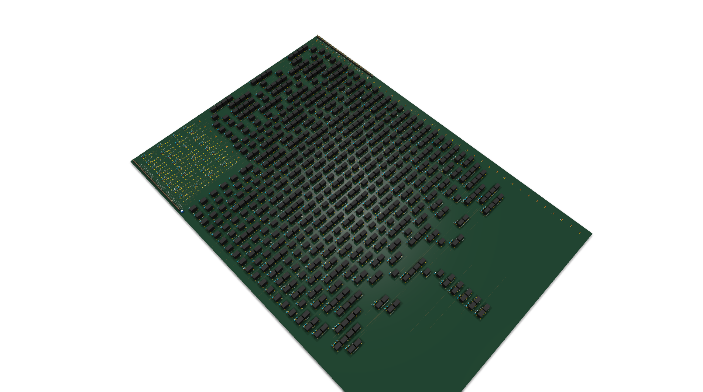
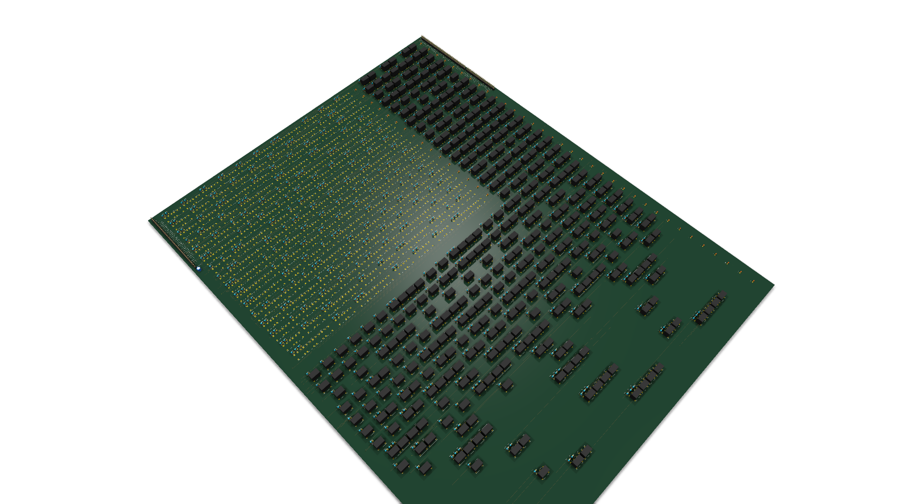
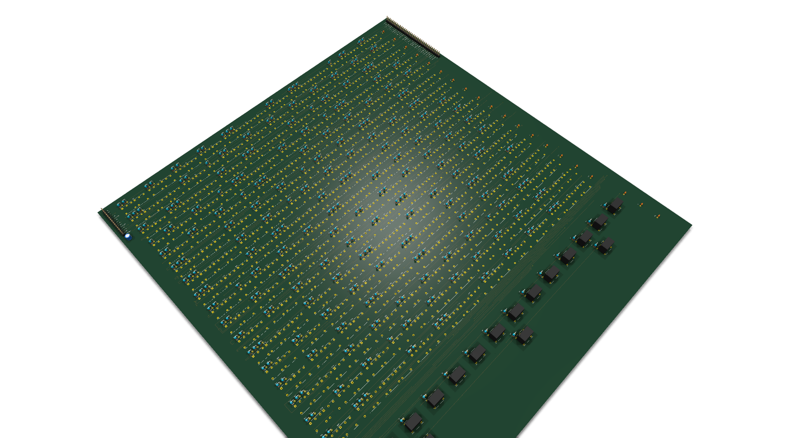
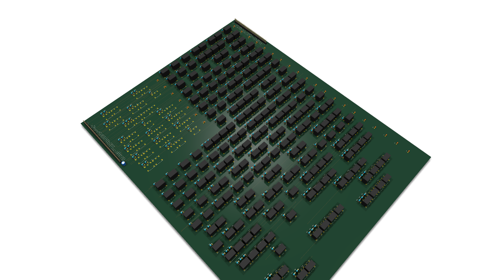

# SERV (RV32I Bit-Serial) no fr4lane

Implementação em **SystemVerilog moderno** do núcleo [SERV](https://github.com/olofk/serv) (o menor processador RISC-V do mundo, criado por Olof Kindgren, vencedor do prêmio *World's Smallest RISC-V CPU*).

Esta versão foi portada para SystemVerilog limpo com uso consistente de `logic`, `always_ff`, `always_comb` e pacotes tipados (`serv_pkg.sv`), sintetizável e roteável em placas de circuito impresso usando a ferramenta **fr4lane** em duas tecnologias:
1. **Lógica de Transistores Discretos RTL** (BC548 + resistores);
2. **Lógica a Relés Eletromecânicos** (relés SPDT Omron G5V-1 de 5 V + diodos 1N4148 de supressão).

---

## 1. Arquitetura

O SERV processa operações de 32 bits de forma **bit-serial** (1 bit por ciclo de clock):
- **Ciclos por instrução**: Tipicamente 32 ciclos para operações aritméticas/lógicas (OP e OP-IMM), além de ciclos de busca e alinhamento de memória.
- **Banco de Registradores (RF)**: Mapeado externamente em uma SRAM síncrona de 2 bits de largura ($512 \times 2 = 1024$ bits = 32 registradores $\times$ 32 bits), minimizando o número de flip-flops discretos na placa (`serv_rf_ram_if.sv`).
- **Barramentos Wishbone clássicos**:
  - `o_ibus_*`: Barramento de instruções (busca de 32 bits).
  - `o_dbus_*`: Barramento de dados (`LOAD`/`STORE` com sinais de seleção de byte `dbus_sel[3:0]`).
- **Sem CSRs**: Configurado como `WITH_CSR = 0` para simplificação máxima do hardware físico.

---

## 2. Arquitetura Modular Multi-Placa (Pilha de 4 Placas)

Para viabilizar a fabricação e montagem prática, o SERV foi particionado em **4 placas modulares empilháveis** interligadas por um barramento padronizado e verificadas em conjunto pelo `fr4lane-system` (`serv_system.sv`):

| Placa | Função | Módulos Internos | Macro Hierárquico |
|---|---|---|---|
| **`serv_ctrl_board`** | Controle e Decodificação | `serv_state`, `serv_decode`, `serv_immdec` | `serv_immdec` |
| **`serv_pc_board`** | Program Counter e Branch | `serv_ctrl` | `serv_ctrl` |
| **`serv_alu_board`** | ALU e Registradores | `serv_alu`, `serv_bufreg`, `serv_bufreg2` | `serv_alu` |
| **`serv_rf_mem_board`** | Banco de Regs e Memória | `serv_rf_if`, `serv_rf_ram_if`, `serv_mem_if` | `serv_mem_if` |

Todas as placas contam com `"buffer_ports": true` em seus arquivos de floorplan, garantindo que as linhas do barramento da pilha vejam apenas uma carga de entrada por placa.

---

## 3. Implementação em Tecnologia Relay (Relés SPDT)

Usando a biblioteca `relay` (`--lib relay`), cada contato de relé atua como uma chave bidirecional (MUX2 com 1 relé, XOR com 2 relés), com bobinas de 5 V (~30 mA) e diodos 1N4148:

| Placa | Relés (Omron G5V-1) | Diodos (1N4148) | Dimensões da Placa | Conflitos de Roteamento |
|---|---:|---:|---:|---:|
| **`serv_ctrl_board`** | 741 | 692 | 520 × 660 mm | 0 (12 iterações) |
| **`serv_pc_board`** | 403 | 369 | 400 × 420 mm | 0 (7 iterações) |
| **`serv_alu_board`** | 738 | 671 | 520 × 750 mm | 0 (10 iterações) |
| **`serv_rf_mem_board`** | 257 | 237 | 320 × 400 mm | 0 (8 iterações) |
| **Total da CPU** | **2.139 relés** | **1.969 diodos** | **4 placas modulares** | **100% Roteado** |

### Galeria 3D (Renderização KiCad Raytracing)

#### Placa da ALU (`serv_alu_board`)
<p align="center">
  
</p>

#### Placa de Controle (`serv_ctrl_board`)
<p align="center">
  
</p>

#### Placa do Program Counter (`serv_pc_board`)
<p align="center">
  
</p>

#### Placa do Register File e Memória (`serv_rf_mem_board`)
<p align="center">
  
</p>

---

## 4. Comandos de Geração e Validação

### Síntese e Validação do Sistema
```bash
# Síntese das 4 placas com relés
python -m fr4lane --top serv_ctrl_board --lib relay --synth-only
python -m fr4lane --top serv_pc_board --lib relay --synth-only
python -m fr4lane --top serv_alu_board --lib relay --synth-only
python -m fr4lane --top serv_rf_mem_board --lib relay --synth-only

# Validação multi-board (262 ligações verificadas, 0 erros)
python -m fr4lane.system --top serv_system \
  --boards serv_ctrl_board serv_pc_board serv_alu_board serv_rf_mem_board \
  --lib relay
```

### Roteamento e Geração do KiCad
```bash
python -m fr4lane --top serv_ctrl_board --lib relay --no-drc
python -m fr4lane --top serv_pc_board --lib relay --no-drc
python -m fr4lane --top serv_alu_board --lib relay --no-drc
python -m fr4lane --top serv_rf_mem_board --lib relay --no-drc
```

### Renderização 3D das Placas
```bash
kicad-cli pcb render \
  --output build/pcb/serv_alu_board_relay/render_3d.png \
  --rotate -30,0,45 --perspective --floor --width 1920 --height 1080 \
  build/pcb/serv_alu_board_relay/serv_alu_board_relay.kicad_pcb
```

---

## 5. Compilação de Programas C com Clang / LLVM

```bash
# 1. Compilar para objeto RV32I bare-metal
clang --target=riscv32 -march=rv32i -mabi=ilp32 -O2 -c \
      -nostdlib -ffreestanding -fno-builtin \
      main.c -o main.o

# 2. Ligar com endereço base 0x00000000
ld.lld -Ttext 0x00000000 -melf32lriscv main.o -o main.elf

# 3. Gerar arquivo hexadecimal para o testbench
llvm-objcopy -O verilog main.elf prog.hex
```

O testbench `tb/tb_serv_system.sv` executa o programa e confere o resultado:
```
OK: serv_system: 40 + 2 = 42 em 146 ciclos de clock
```
