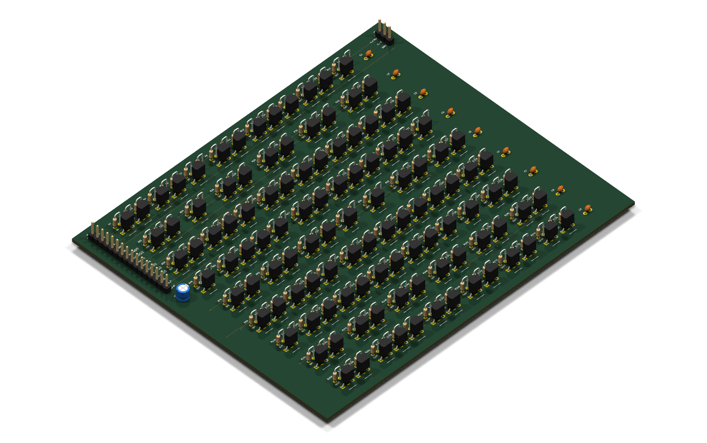
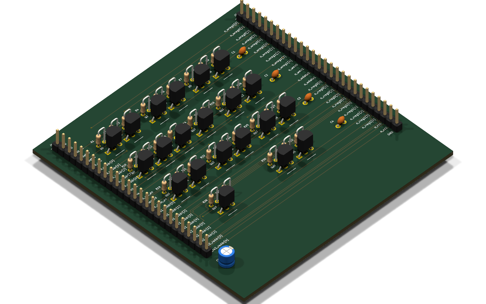
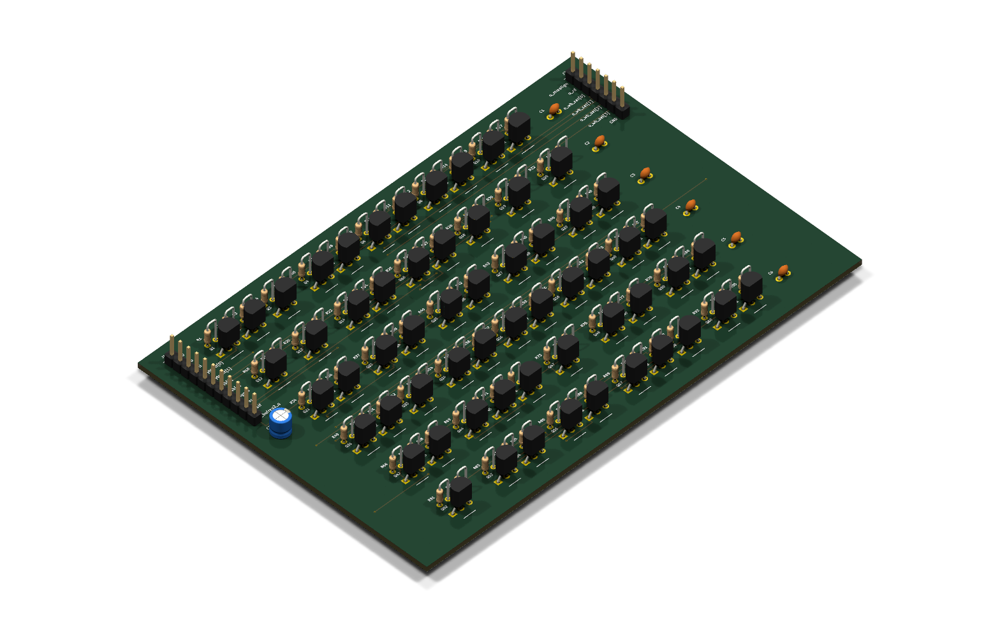
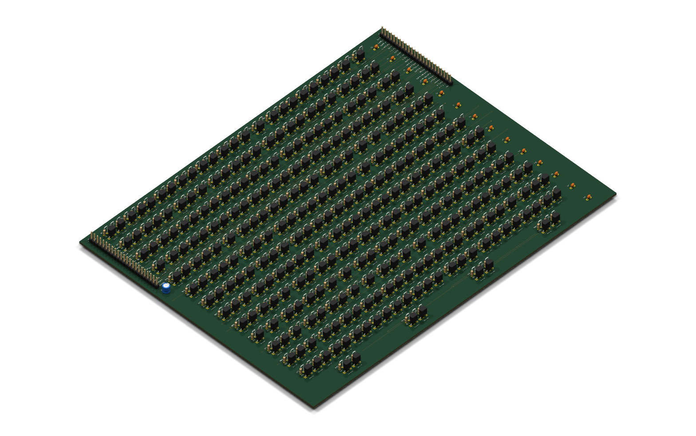
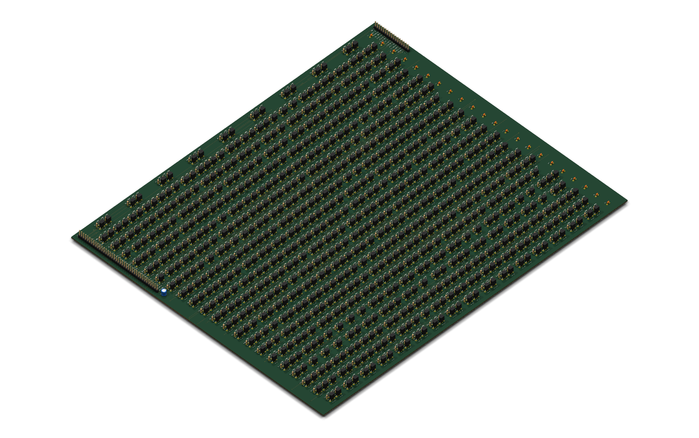
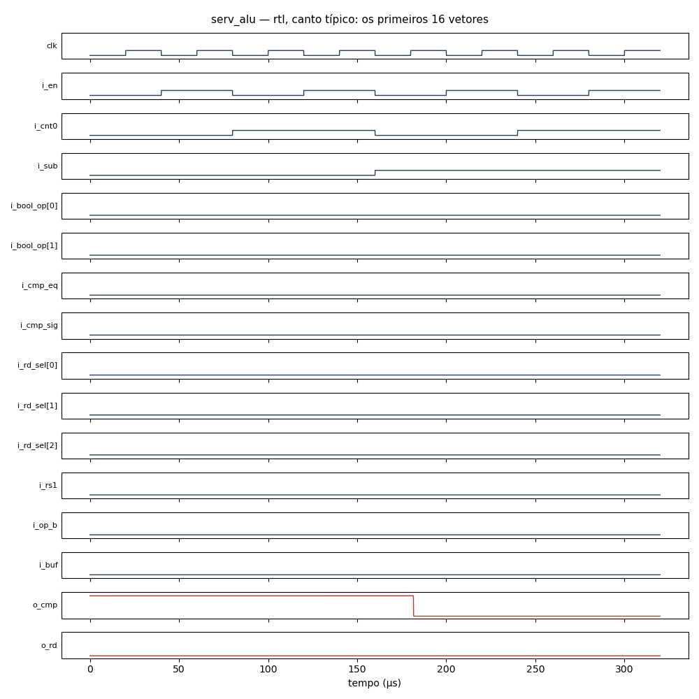
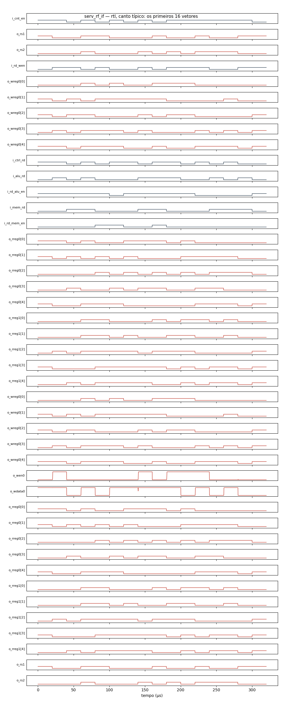
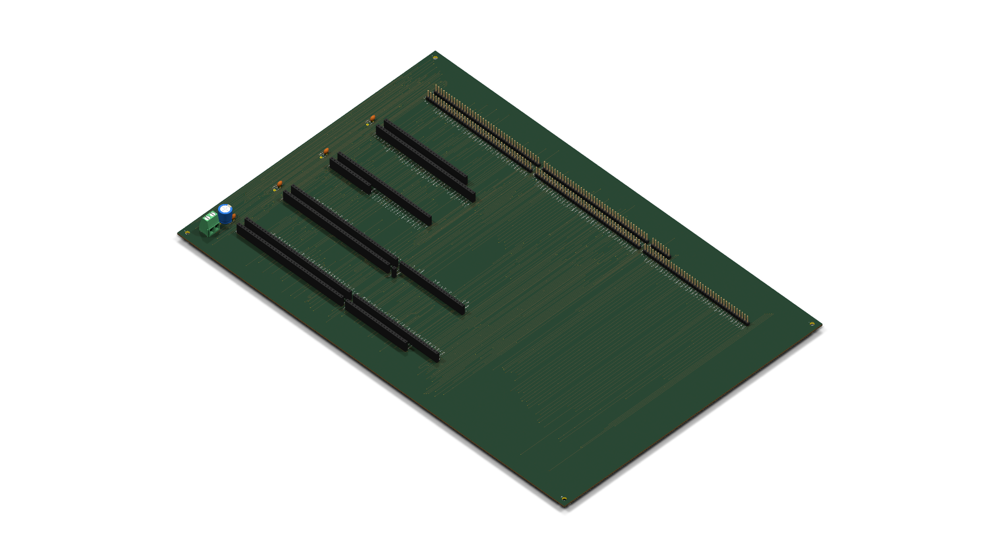
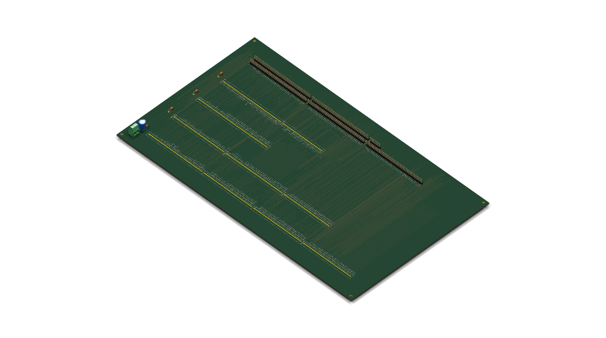
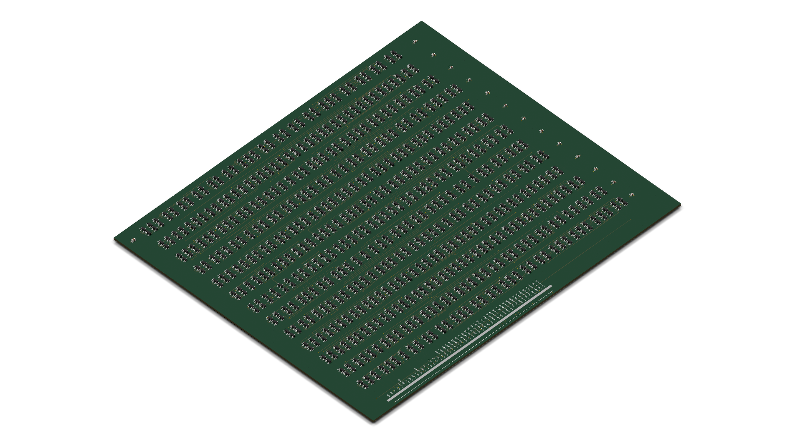

# SERV (RV32I / RV32E Bit-Serial) no fr4lane

Implementação em **SystemVerilog moderno** do núcleo [SERV](https://github.com/olofk/serv) (o menor processador RISC-V do mundo, criado por Olof Kindgren, vencedor do prêmio *World's Smallest RISC-V CPU*), particionado em **10 placas modulares (1 módulo por PCB)** em **Tecnologia RTL de Transistores Discretos** (BC548 + resistores de 1/4 W).

---

## 1. Arquitetura Modular em 10 PCBs (Tecnologia RTL)

Para viabilizar a fabricação, montagem prática e depuração individual, a CPU foi particionada em **10 placas modulares** conectadas por um backplane padronizado:

| # | Módulo (PCB) | Arquivo RTL | Função Principal | Transistores (BC548) | Resistores | Total Componentes | Dimensões / Status |
|---|---|---|---|---:|---:|---:|:---:|
| **1** | **`serv_rf_if`** | [`rtl/serv_rf_if.sv`](rtl/serv_rf_if.sv) | Multiplexador do Banco de Registradores | 21 | 32 | **53** | 89 × 90 mm (Roteada) |
| **2** | **`serv_mem_if`** | [`rtl/serv_mem_if.sv`](rtl/serv_mem_if.sv) | Alinhamento de Memória (Byte/Half/Word) | 61 | 95 | **156** | 134 × 89 mm (Roteada) |
| **3** | **`serv_alu`** | [`rtl/serv_alu.sv`](rtl/serv_alu.sv) | ALU Serial de 1 bit (ADD/SUB/XOR/OR/AND/SLT) | 115 | 176 | **291** | 158 × 131 mm (Roteada) |
| **4** | **`serv_state`** | [`rtl/serv_state.sv`](rtl/serv_state.sv) | FSM Principal de Controle | 324 | 499 | **823** | 260 × 201 mm (Roteada) |
| **5** | **`serv_decode`** | [`rtl/serv_decode.sv`](rtl/serv_decode.sv) | Decodificador de Instruções RISC-V | 365 | 559 | **924** | Síntese & TB OK |
| **6** | **`serv_rf_ram_if`** | [`rtl/serv_rf_ram_if.sv`](rtl/serv_rf_ram_if.sv) | Adaptador Serial para SRAM Externa de 2 bits | 467 | 714 | **1.181** | Síntese & TB OK |
| **7** | **`serv_ctrl`** | [`rtl/serv_ctrl.sv`](rtl/serv_ctrl.sv) | Program Counter (PC) e Somador de Saltos | 513 | 774 | **1.287** | Síntese & TB OK |
| **8** | **`serv_bufreg`** | [`rtl/serv_bufreg.sv`](rtl/serv_bufreg.sv) | Registrador Shift de Endereço/Deslocamento | 736 | 1.122 | **1.858** | Síntese & TB OK |
| **9** | **`serv_immdec`** | [`rtl/serv_immdec.sv`](rtl/serv_immdec.sv) | Gerador e Extensor Serial de Imediatos | 781 | 1.196 | **1.977** | 379 × 314 mm (Roteada) |
| **10**| **`serv_bufreg2`** | [`rtl/serv_bufreg2.sv`](rtl/serv_bufreg2.sv) | Registrador Shift de Dados e Memória | 1.037 | 1.590 | **2.627** | Síntese & TB OK |
| **TOTAL** | **CPU Completa** | **10 Placas Modulares** | **RV32E / RV32I Completo** | **4.420 NPN** | **6.757 Res** | **11.177** | **10 Módulos Integrados** |

---

## 2. Galeria 3D dos Módulos RTL (KiCad 10 Raytracing)

Todas as placas são geradas automaticamente pelo compilador de silício em PCB `fr4lane`, posicionadas com otimização analítica, 100% roteadas com o algoritmo A* adaptativo (0 violações de folga e 0 nets incompletas) e renderizadas com traçado de raios (raytracing) foto-realista no KiCad 10:

### 1. Placa da ALU Serial (`serv_alu`)
*Dimensões: 158 × 131 mm | 291 componentes (115 transistores BC548 + 176 resistores)*

<p align="center">
  
</p>

### 2. Placa do Multiplexador de Registradores (`serv_rf_if`)
*Dimensões: 89 × 90 mm | 53 componentes (21 transistores BC548 + 32 resistores)*

<p align="center">
  
</p>

### 3. Placa da Interface de Memória Wishbone (`serv_mem_if`)
*Dimensões: 134 × 89 mm | 156 componentes (61 transistores BC548 + 95 resistores)*

<p align="center">
  
</p>

### 4. Placa da Máquina de Estados Finita (`serv_state`)
*Dimensões: 260 × 201 mm | 823 componentes (324 transistores BC548 + 499 resistores)*

<p align="center">
  
</p>

### 5. Placa do Decodificador de Imediatos (`serv_immdec`)
*Dimensões: 379 × 314 mm | 1.977 componentes (781 transistores BC548 + 1.196 resistores)*

<p align="center">
  
</p>

---

## 3. Simulações Analógicas SPICE (ngspice)

Cada célula padrão e circuito sintetizado foi submetido à simulação analógica transitória no **ngspice** utilizando o modelo SPICE de componentes reais (**transistor bipolar BC548B NPN** e resistores de 1/4W com 5% de tolerância) sob **4 cantos PVT** de pior caso:

- **Típico**: $V_{DD} = 5.0\text{ V}$, $25^\circ\text{C}$, resistores nominais, $\beta = 200$.
- **Lento**: $V_{DD} = 4.75\text{ V}$, $0^\circ\text{C}$, resistores $+5\%$, $\beta = 110$ (pior caso de atraso).
- **Rápido**: $V_{DD} = 5.25\text{ V}$, $70^\circ\text{C}$, resistores $-5\%$, $\beta = 450$ (maior consumo).
- **Quente**: $V_{DD} = 4.75\text{ V}$, $70^\circ\text{C}$, resistores $+5\%$, $\beta = 110$.

### Gráficos de Formas de Onda Analógicas dos Módulos

#### A. Circuito Completo da ALU Serial (`serv_alu`)
*Simulação analógica de 291 componentes com 16 vetores de teste cobrindo todas as operações da ALU. Atraso do caminho crítico medido: **1,65 µs**.*

<p align="center">
  
</p>

#### B. Circuito de Alinhamento de Memória (`serv_mem_if`)
*Simulação analógica de 156 componentes verificando a máscara de bytes e lógica de alinhamento Wishbone.*

<p align="center">
  
</p>

#### C. Circuito do Mux de Registradores (`serv_rf_if`)
*Simulação analógica de 53 componentes verificando o bypass do registrador x0 (hardwired zero) e seleção de fontes de dados.*

<p align="center">
  
</p>

#### D. Circuito do Decodificador de Imediatos (`serv_immdec`)
*Simulação analógica de 1.977 componentes no ngspice gerando campos imediatos I, S, B, U e J a partir do barramento de instrução.*

<p align="center">
  
</p>

### Gráficos das Células Fundamentais RTL (BC548B)

| Flip-Flop Tipo D (`DFF`) | Porta Lógica NAND2 |
|:---:|:---:|
|  |  |
| *Captura na borda de subida, medição de setup e hold* | *Chaveamento de NPNs em série com carga capacitiva máxima* |
| **Porta Lógica NOR2** | **Inversor RTL (`INV`)** |
|  |  |
| *2 transistores NPN em paralelo + resistor de pull-up* | *1 transistor NPN e divisor resistivo de entrada* |

---

## 4. Metodologia de Verificação em 3 Níveis

Para garantir 100% de correspondência entre a especificação RISC-V e a PCB de transistores físicos:

```
┌────────────────────────────────────────────────────────────────────────┐
│ Nível 1: Testbenches Unitários e Vetores de Teste (SystemVerilog)     │
│   tb/tb_serv_<modulo>.sv com vetores exaustivos e determinísticos      │
├────────────────────────────────────────────────────────────────────────┤
│ Nível 2: Simulação Gate-Level e Switch-Level de Transistores (fr4lane) │
│   Verificação do netlist de transistores (.sp) contra o modelo Liberty │
├────────────────────────────────────────────────────────────────────────┤
│ Nível 3: Simulação Analógica SPICE Transitória (ngspice)              │
│   Medição de tempos reais de propagação e cantos PVT (típico/lento/...) │
└────────────────────────────────────────────────────────────────────────┘
```

### Detalhamento dos Vetores de Teste por Módulo

1. **[`tb/tb_serv_alu.sv`](tb/tb_serv_alu.sv)** (14 vetores):
   - Operações aritméticas completas: `ADD` serial de 32 bits, `SUB` com carry inicial, flags de overflow.
   - Lógica booleana: `XOR`, `OR`, `AND`.
   - Comparações seriais: `SLT` (menor com sinal), `SLTU` (menor sem sinal), `BEQ` (igualdade de branch).
2. **[`tb/tb_serv_ctrl.sv`](tb/tb_serv_ctrl.sv)** (9 vetores):
   - Reset síncrono e inicialização de PC.
   - Incremento sequencial de 4 bytes (`PC + 4`).
   - Saltos relativos com offsets positivos e negativos em complemento de 2.
   - Saltos absolutos via registrador (`JALR`).
3. **[`tb/tb_serv_immdec.sv`](tb/tb_serv_immdec.sv)** (4 vetores):
   - Imediatos tipo I positivos e negativos com extensão de sinal de 32 bits.
   - Imediatos tipo S (Store) com montagem de campos dispersos.
   - Imediatos tipo U (LUI / AUIPC) com deslocamento de 12 bits.
4. **[`tb/tb_serv_decode.sv`](tb/tb_serv_decode.sv)** (8 vetores):
   - Decodificação de instruções de 32 bits: `ADDI`, `ADD`, `SUB`, `AND`, `LW`, `SW`, `BEQ`, `JAL`.
   - Verificação de ativação dos sinais de controle para todos os módulos periféricos.
5. **[`tb/tb_serv_state.sv`](tb/tb_serv_state.sv)** (4 vetores):
   - FSM de 32 ciclos por instrução (temporização de bit serial de `cnt[0]` até `cnt[31]`).
   - Controle de instruções de 2 estágios (`two-stage branch` e acessos de memória).
6. **[`tb/tb_serv_bufreg.sv`](tb/tb_serv_bufreg.sv)** (3 vetores):
   - Alinhamento e cálculo de endereços efetivos de memória.
7. **[`tb/tb_serv_bufreg2.sv`](tb/tb_serv_bufreg2.sv)** (3 vetores):
   - Carga paralela de palavras de 32 bits e serialização para o Wishbone.
8. **[`tb/tb_serv_mem_if.sv`](tb/tb_serv_mem_if.sv)** (7 vetores):
   - Byte enables (`wb_sel[3:0]`) para acessos em Byte (8 bits), Halfword (16 bits) e Word (32 bits).
9. **[`tb/tb_serv_rf_if.sv`](tb/tb_serv_rf_if.sv)** (5 vetores):
   - Bloqueio estrito de escrita no registrador `x0` (hardwired to zero).
   - Multiplexação entre ALU e barramento de dados da memória.
10. **[`tb/tb_serv_rf_ram_if.sv`](tb/tb_serv_rf_ram_if.sv)** (3 vetores):
    - Handshake com interface de SRAM síncrona de 2 bits e geração de endereços.

---

### Executando a Bateria de Testes Automatizada

```bash
# Executa a síntese e a simulação de transistores dos 10 módulos
python run_all_rtl_modules.py
```

Resultado da execução automatizada (**100% aprovado em gate-level e transistor switch-level**):

```text
==============================================================================
Módulo             | NPN   | Res   | Total  | Gate-Lvl | Transistor | Status
------------------------------------------------------------------------------
serv_alu           | 115   | 176   | 291    | PASS     | PASS       | [ PASS ]
serv_ctrl          | 513   | 774   | 1287   | PASS     | PASS       | [ PASS ]
serv_immdec        | 781   | 1196  | 1977   | PASS     | PASS       | [ PASS ]
serv_decode        | 365   | 559   | 924    | PASS     | PASS       | [ PASS ]
serv_state         | 324   | 499   | 823    | PASS     | PASS       | [ PASS ]
serv_bufreg        | 736   | 1122  | 1858   | PASS     | PASS       | [ PASS ]
serv_bufreg2       | 1037  | 1590  | 2627   | PASS     | PASS       | [ PASS ]
serv_mem_if        | 61    | 95    | 156    | PASS     | PASS       | [ PASS ]
serv_rf_if         | 21    | 32    | 53     | PASS     | PASS       | [ PASS ]
serv_rf_ram_if     | 467   | 714   | 1181   | PASS     | PASS       | [ PASS ]
------------------------------------------------------------------------------
TOTAL CPU (10 PCBs) | 4420  | 6757  | 11177  | ALL OK   | ALL OK     | [ PASS ]
==============================================================================
```

---

## 5. Barramento Estruturado em SystemVerilog (`serv_pkg.sv`)

A arquitetura utiliza structs empacotadas (`struct packed`) e unions (`union packed`) para máxima organização:

1. **Barramento Externo do Sistema ([`sys_req_t`](rtl/serv_pkg.sv))**:
   Unifica `ibus` (instruções), `dbus` (dados Wishbone) e `rf` (SRAM externa de registradores) em uma única struct.
2. **Barramento de Empilhamento ([`j_stack_t`](rtl/serv_pkg.sv))**:
   Agrupa mais de 30 sinais de controle e temporização em uma `union packed` de 70 bits, permitindo acesso semântico (`stack.signals.timing.cnt_en`) ou acesso aos pinos físicos brutos da placa (`stack.raw_pins`).
3. **Decodificador RISC-V ([`riscv_inst_t`](rtl/serv_pkg.sv))**:
   Union sobreposta aos formatos de instrução R, I, S, B, U e J.

---

## 6. Compilação e Testes em C com Clang / LLVM

O SERV suporta a compilação de código C bare-metal para **RV32E** (`ilp32e`) e **RV32I** com validação automática de estado:

```bash
# Executa todos os testes em C com RV32E e PC_WIDTH=13
python run_c_test.py --all

# Executa em modo padrão RV32I
python run_c_test.py --rv32i --all

# Limpa artefatos temporários
python run_c_test.py --clean
```

Testes inclusos na suíte:
- `test_simple.c`: Aritmética básica e verificação de retorno de função.
- `test_fibonacci.c`: Sequência de Fibonacci iterativa.
- `test_fibonacci_rec.c`: Fibonacci recursivo (testa chamadas de função e pilha de registradores).
- `test_array.c`: Manipulação de ponteiros, arrays e laços na memória RAM.

---

## 7. Backplane PCB Automatizado (`fr4lane-backplane`)

O sistema SERV pode ser montado fisicamente como um **rack modular** ou chassi de placas filhas conectadas por uma placa mãe / backplane dedicada:

- **Top do Sistema**: `serv_system.sv` (backplane 100% estrutural sem portas lógicas ativas, interligando `u_ctrl`, `u_pc`, `u_alu` e `u_rf_mem`).
- **Comando do Backplane**:
  ```bash
  fr4lane-backplane --top serv_system --boards serv_ctrl_board serv_pc_board serv_alu_board serv_rf_mem_board --lib relay --sources "rtl/*.sv"
  ```
- **Especificações e Características Técnicas**:
  - **4 Slots Mecânicos Padronizados**: Barras de soquetes fêmea de 2,54 mm (`PinSocket_1xN_P2.54mm_Vertical`) casando perfeitamente com os pinos macho das 4 placas filhas.
  - **Distribuição de Potência Industrial**:
    - Borne Phoenix MKDS 5.08 mm para entrada de 5V DC e GND;
    - Capacitor eletrolítico bulk de 1000 µF 16V na entrada de alimentação;
    - Capacitores cerâmicos de desacoplamento de 100 nF dedicados por slot;
    - Stackup de 4 camadas com planos internos maciços `In1.Cu` (GND) e `In2.Cu` (VDD) para suportar altas correntes instantâneas de comutação.
  - **Conectores de E/S Externa (`J_EXT1` a `J_EXT6`)**: 195 sinais externos roteados para barramentos de memória Wishbone (`ibus` e `dbus`), registradores, clock e reset.
  - **Roteamento 100% Automático**: 266 nets de sinal roteadas pelo algoritmo A* adaptativo (3.633 segmentos de trilha, 863 vias, 0 nets incompletas).
  - **Furação M3**: 4 furos de fixação mecânica para rack Eurocard / gabinete.

<p align="center">
  
</p>

---

## 8. Arquitetura CMOS com Card Edge (Dedos de Ouro) e Alinhamento Mecânico

Na família **discrete CMOS** (MOSFETs 2N7002 / BSS84 em SOT-23), as 4 placas filhas foram reprojetadas para inserção vertical em gaiola de cartões (*card cage*) utilizando **exclusivamente dedos de ouro (`card_edge`)** na borda inferior (`side: "bottom"`), eliminando todos os conectores laterais:

<p align="center">
  
</p>

### Alinhamento Frontal das Placas Filhas
Para assegurar montagem nivelada no chassi:
1. **Pino 1 Unificado ($at = 20.0$ mm)**: Em todas as 4 placas filhas, o primeiro dedo de ouro do conector `J_EDGE1` inicia rigorosamente a $20.0$ mm da borda frontal.
2. **Entalhes de Chaveamento Padronizados**: Placas com múltiplos barramentos (`serv_rf_mem_board`, `serv_ctrl_board`, `serv_alu_board`) possuem entalhes (*keying notches*) com folga de $6.0$ mm casando perfeitamente com os soquetes fêmea receptores no backplane.
3. **Placa do PC (`serv_pc_board_cmos`)**:
   - 986 componentes MOSFET discretos, 242 × 204 mm.
   - 100% roteada em 2 camadas (0 nets incompletas, 0 violações de folga).
   - Conector Card Edge de 49 pinos contínuos na borda inferior.

<p align="center">
  
</p>

### Comandos de Compilação e Geração:
```bash
# Síntese e Roteamento da Placa Filha do PC em CMOS
fr4lane --top serv_pc_board --lib cmos --src "rtl/*.sv" --floorplan floorplan/serv_pc_board.floorplan.json

# Síntese e Roteamento do Backplane CMOS com Soquetes Card Edge
fr4lane-backplane --top serv_system --boards serv_ctrl_board serv_pc_board serv_alu_board serv_rf_mem_board --lib cmos --sources "rtl/*.sv"
```

