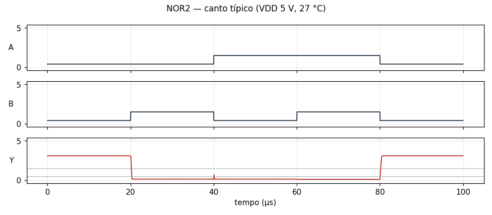
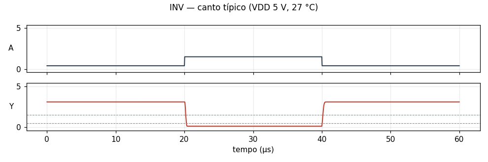
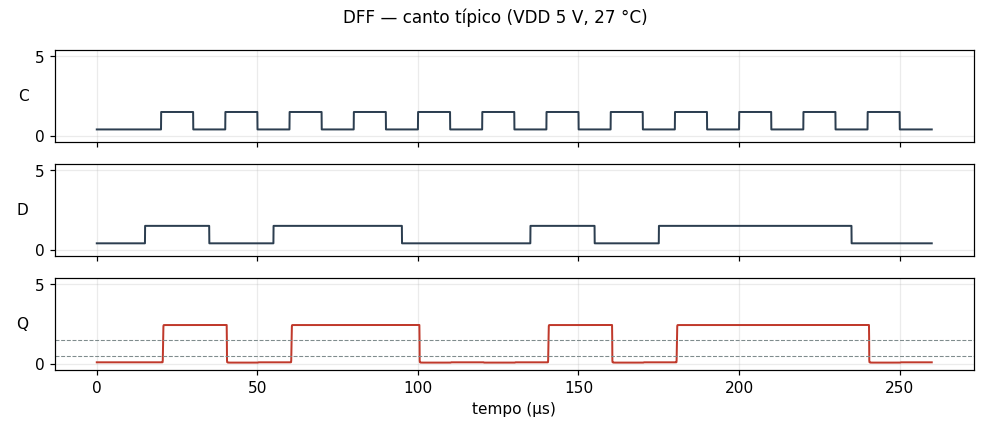

# Células da família `rtl` no ngspice

Cada célula da família é simulada como circuito de verdade, com o modelo SPICE dos componentes, e não só como chaves ideais. Os resultados de todos os cantos estão em [resultados.md](resultados.md).

## Reproduzir

Cada `<CÉLULA>.cir` é um netlist do ngspice completo: o modelo do transistor, os subcircuitos da célula e da carga, as fontes com os vetores de teste e as medidas. O cabeçalho explica os vetores e o valor esperado de cada medida. É o teste funcional no canto típico.

```sh
ngspice -b NAND2.cir      # imprime as medidas e grava NAND2.dat com as formas de onda
```

Para rodar todos os cantos e refazer estes arquivos: `fr4lane-cellsim --lib rtl --export examples/serv/img/spice`.

## Células

### NAND2

NAND de 2 entradas RTL (NPNs em série)

[NAND2.cir](NAND2.cir) — passa no canto típico


### NOR2

NOR de 2 entradas RTL

[NOR2.cir](NOR2.cir) — passa no canto típico



### INV

inversor RTL (1 NPN + 2 resistores)

[INV.cir](INV.cir) — passa no canto típico



### DFF

flip-flop D, borda de subida (6 NORs + inversor de clock)

[DFF.cir](DFF.cir) — passa no canto típico



## Circuito serv_alu

Um circuito inteiro, sintetizado pelo fr4lane: 44 células, 291 componentes e 16 vetores. Resultados e gráfico em [serv_alu.md](serv_alu.md); dados em [serv_alu.csv](serv_alu.csv); netlist em [serv_alu.cir](serv_alu.cir).

## Circuito serv_rf_if

Um circuito inteiro, sintetizado pelo fr4lane: 9 células, 53 componentes e 16 vetores. Resultados e gráfico em [serv_rf_if.md](serv_rf_if.md); dados em [serv_rf_if.csv](serv_rf_if.csv); netlist em [serv_rf_if.cir](serv_rf_if.cir).

## Circuito serv_mem_if

Um circuito inteiro, sintetizado pelo fr4lane: 27 células, 156 componentes e 16 vetores. Resultados e gráfico em [serv_mem_if.md](serv_mem_if.md); dados em [serv_mem_if.csv](serv_mem_if.csv); netlist em [serv_mem_if.cir](serv_mem_if.cir).

## Circuito serv_immdec

Um circuito inteiro, sintetizado pelo fr4lane: 221 células, 1977 componentes e 16 vetores. Resultados e gráfico em [serv_immdec.md](serv_immdec.md); dados em [serv_immdec.csv](serv_immdec.csv); netlist em [serv_immdec.cir](serv_immdec.cir).

