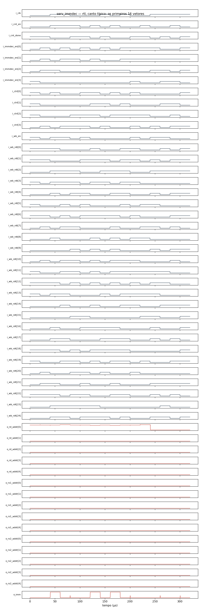

# Circuito `serv_immdec` na família `rtl` (ngspice)

221 células, 1977 componentes, 16 vetores (todas as combinações das entradas, simuladas em lotes de 64). Cada vetor é conferido contra a lógica do netlist; o caminho crítico é o último cruzamento de uma saída depois da mudança das entradas. O netlist publicado tem os primeiros 16 vetores.

| Canto | Resultado | Sem convergir | Caminho crítico |
|---|---|---:|---|
| típico | **15 saídas erradas** | — | — |
| lento | **80 saídas erradas** | — | — |
| rápido | OK | — | — |
| quente | **98 saídas erradas** | — | — |

Dados completos de todos os vetores e cantos em [serv_immdec.csv](serv_immdec.csv). Reproduzir (canto típico): `ngspice -b serv_immdec.cir`

