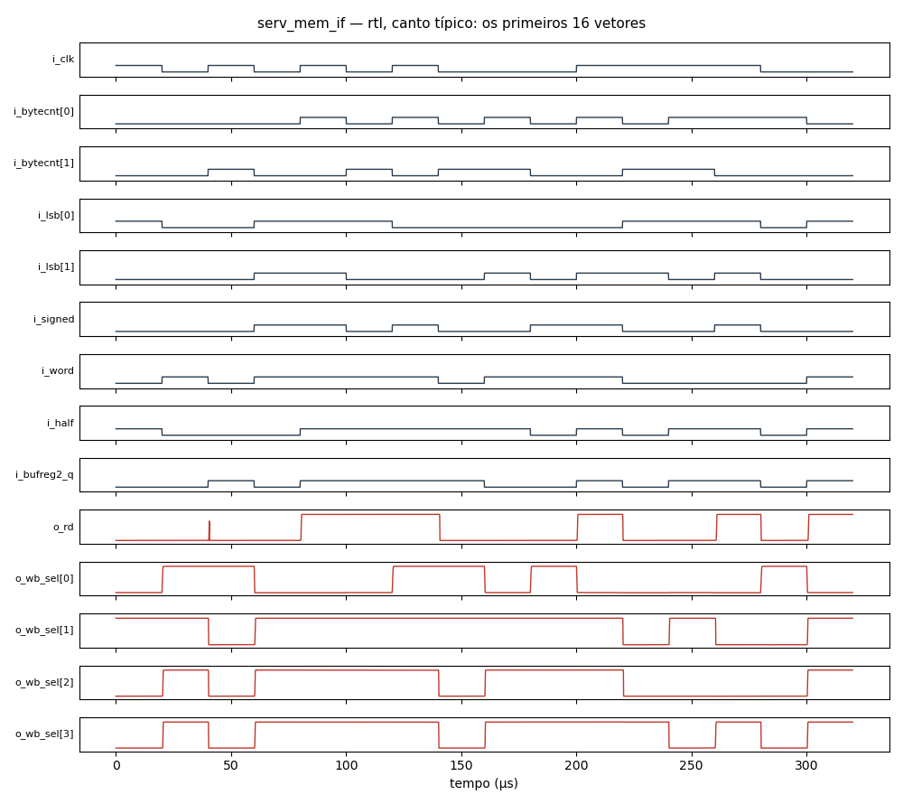

# Circuito `serv_mem_if` na família `rtl` (ngspice)

27 células, 156 componentes, 16 vetores (todas as combinações das entradas, simuladas em lotes de 64). Cada vetor é conferido contra a lógica do netlist; o caminho crítico é o último cruzamento de uma saída depois da mudança das entradas. O netlist publicado tem os primeiros 16 vetores.

| Canto | Resultado | Sem convergir | Caminho crítico |
|---|---|---:|---|
| típico | OK | 17 % | 826 ns (o_rd no vetor 13) |
| lento | OK | 17 % | 796 ns (o_rd no vetor 13) |
| rápido | OK | 17 % | 927 ns (o_rd no vetor 13) |
| quente | OK | 17 % | 894 ns (o_rd no vetor 13) |

Dados completos de todos os vetores e cantos em [serv_mem_if.csv](serv_mem_if.csv). Reproduzir (canto típico): `ngspice -b serv_mem_if.cir`

