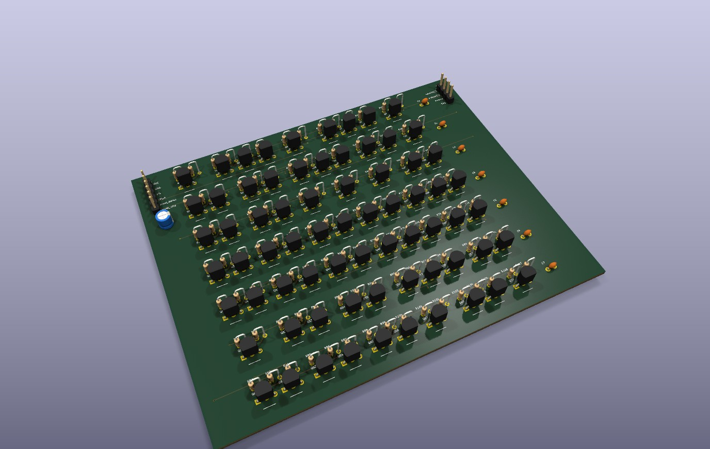
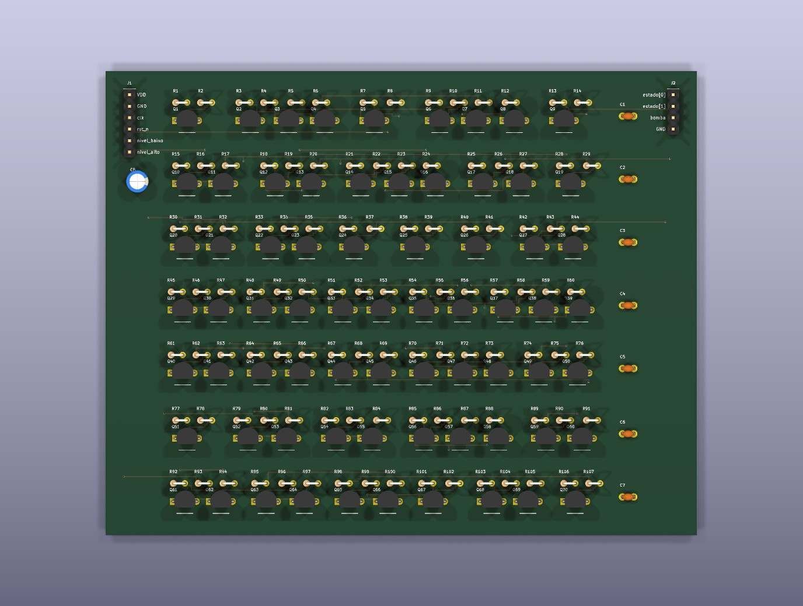

# Controle de bomba d'água (`tanque`)

Máquina de estados finitos (FSM) de 4 estados em ciclo para controle de uma bomba d'água de um reservatório com dois sensores de nível (`nivel_baixo` e `nivel_alto`), sintetizada para componentes discretos pelo `pcbflow`.

<p align="center">
  
</p>

## Estados e funcionamento

| Estado | Código (`estado[1:0]`) | `bomba` | Próximo estado |
|---|:---:|:---:|---|
| `VAZIO` | `00` | `0` | `ENCHENDO` quando `nivel_baixo == 0` |
| `ENCHENDO` | `01` | `1` | `CHEIO` quando `nivel_alto == 1` |
| `CHEIO` | `10` | `0` | `ESVAZIANDO` quando `nivel_alto == 0` |
| `ESVAZIANDO` | `11` | `0` | `VAZIO` quando `nivel_baixo == 0` |

<p align="center">
  
</p>

## Placa gerada (família RTL)

- **Células:** 21 (`2 DFFR`, `11 NAND2`, `4 INV`, `2 AND2`, `2 NOR2`)
- **Componentes:** 177 (70 transistores BC548 e 107 resistores) + capacitores de desacoplamento
- **Dimensões:** 131 × 103 mm, 4 camadas, 7 fileiras
- **Roteamento e DRC:** 100 % roteada em 7 iterações, 0 violações de folga e 0 erros no DRC do KiCad

## Como gerar e simular

```sh
cd examples/tanque
pcbflow --top tanque --lib rtl                                    # gera a PCB completa em build/pcb/tanque_rtl/
pcbflow-cellsim --lib rtl --design tanque --src tanque.v          # simulação analógica SPICE nos 4 cantos
```
