# Controle de bomba d'água (`tanque`)

Máquina de estados finitos (FSM) de 4 estados em ciclo para controle de uma bomba d'água de um reservatório com dois sensores de nível (`nivel_baixo` e `nivel_alto`), sintetizada para componentes discretos pelo `pcbflow`.

<p align="center">
  
</p>

## Estados e funcionamento

| Estado | Código (`estado[1:0]`) | `bomba` | Próximo estado |
|---|:---:|:---:|---|
| `VAZIO` | `00` | `0` | `ENCHENDO` quando `nivel_baixo == 0` |
| `ENCHENDO` | `01` | `1` | `CHEIO` quando `nivel_alto == 1` |
| `CHEIO` | `10` | `0` | `ESVAZIANDO` quando `nivel_alto == 0` |
| `ESVAZIANDO` | `11` | `0` | `VAZIO` quando `nivel_baixo == 0` |

<p align="center">
  
</p>

## Placas geradas

### Família RTL (`--lib rtl`)

- **Células:** 21 (`2 DFFR`, `11 NAND2`, `4 INV`, `2 AND2`, `2 NOR2`)
- **Componentes:** 177 (70 transistores BC548 e 107 resistores) + capacitores de desacoplamento
- **Dimensões:** 131 × 103 mm, 4 camadas, 7 fileiras
- **Roteamento e DRC:** 100 % roteada em 7 iterações, 0 violações de folga e 0 erros no DRC do KiCad

### Família CTL — Core-Transistor Logic (`--lib ctl`)

Na família **CTL** (núcleos toroidais de ferrite + transistores NPN BC548), as operações `NOR` e `NAND` (por coincidência de corrente e inibição de fluxo magnético) acontecem diretamente nos enrolamentos dos toroides de ferrite, usando um único transistor regenerador por porta:

- **Células:** 17 (`2 DFFR`, `4 INV`, `2 NAND2`, `3 NOR2`, `3 NOR3`, `1 OR2`, `2 XOR2`)
- **Componentes:** 201 (47 núcleos toroidais de ferrite, 38 transistores BC548 e 116 resistores) + capacitores de desacoplamento
- **Dimensões:** 148 × 103 mm, 4 camadas, 7 fileiras
- **Roteamento e DRC:** 100 % roteada em 9 iterações, 0 violações de folga e 0 erros no DRC do KiCad

<p align="center">
  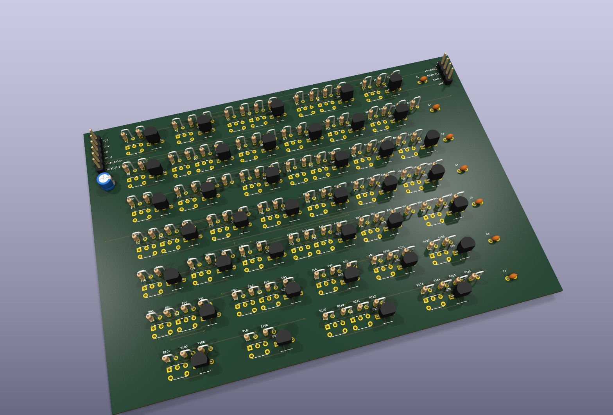
</p>

<p align="center">
  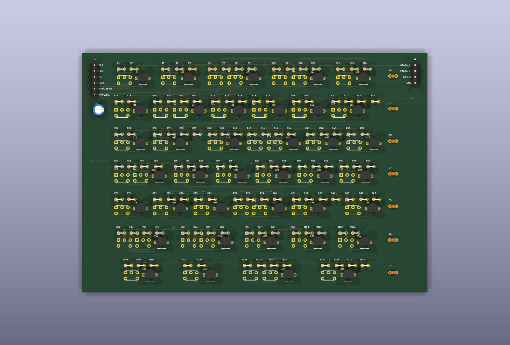
</p>

### Família CDL — Core-Diode Logic (`--lib cdl`)

Na família **CDL** (*Core-Diode Logic*), **não há transistores nem relés**: toda a lógica é realizada exclusivamente por núcleos toroidais de ferrite, diodos de chaveamento `1N4148` (isolamento unidirecional entre entradas) e resistores (`OR` por soma nos enrolamentos, `AND` por coincidência de corrente em um único núcleo e `INV`/`NOR` por inibição de fluxo magnético):

- **Células:** 15 (`1 AND2`, `2 DFFR`, `3 INV`, `2 NOR2`, `4 NOR3`, `1 OR2`, `2 XNOR2`)
- **Componentes:** 201 (33 núcleos toroidais de ferrite, 69 diodos 1N4148 e 99 resistores — **0 transistores**) + capacitores de desacoplamento
- **Dimensões:** 141 × 101 mm, 4 camadas, 7 fileiras
- **Roteamento e DRC:** 100 % roteada em 10 iterações, 0 violações de folga e 0 erros no DRC do KiCad

<p align="center">
  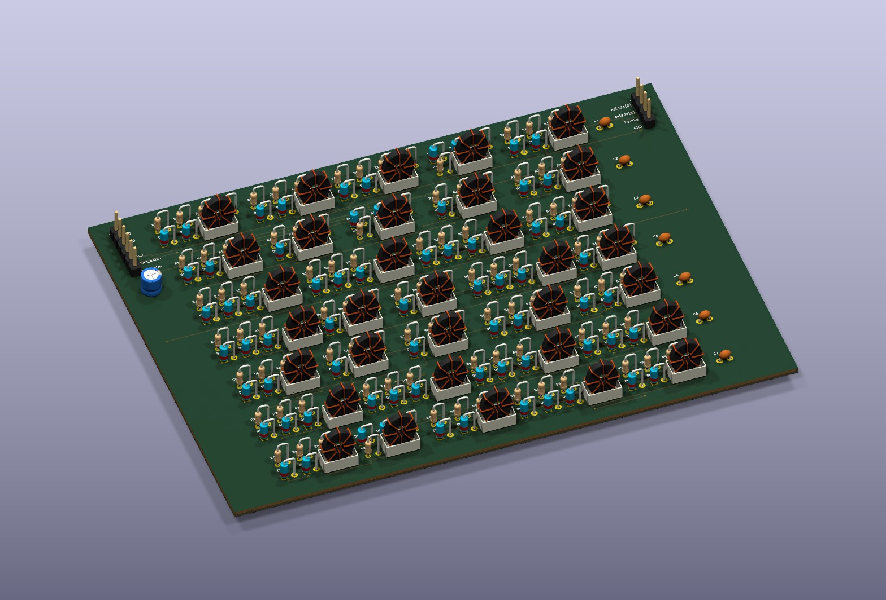
</p>

<p align="center">
  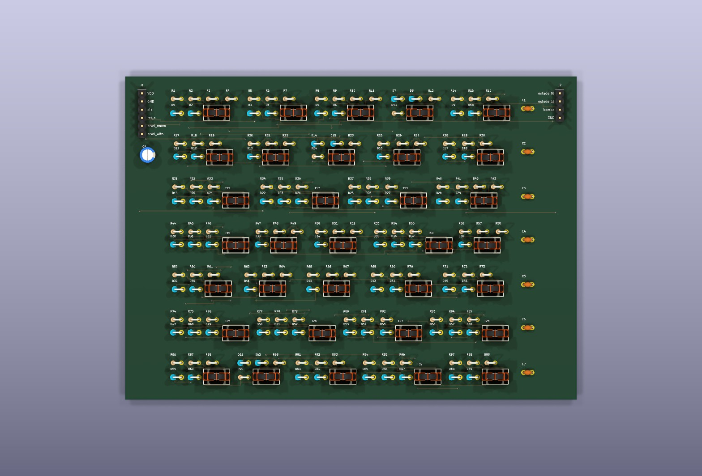
</p>

### Família DTL — Diode-Transistor Logic (`--lib dtl`)

Na família **DTL** (*Diode-Transistor Logic*, estilo IBM 1401 / série 930), as portas de entrada `AND` e `OR` são feitas com diodos `1N4148` seguidos de dois diodos de deslocamento de nível (*level-shift*), resistor de descarga rápida de base (`RB`) e **apenas 1 transistor NPN `BC548` por porta** (incluindo `NAND3` nativa de 1 transistor e `DFFR` estilo 7474 com 6 transistores):

- **Células:** 18 (`2 BUF`, `2 DFFR`, `4 INV`, `2 NAND2`, `5 NAND3`, `1 NOR2`, `2 XOR2`)
- **Componentes:** 292 (**apenas 36 transistores BC548** — metade dos 70 da RTL —, 147 diodos 1N4148 e 109 resistores) + capacitores de desacoplamento
- **Dimensões:** 171 × 131 mm, 4 camadas, 9 fileiras
- **Roteamento e DRC:** 100 % roteada em 9 iterações (1 s), 0 violações de folga e 0 erros no DRC do KiCad

<p align="center">
  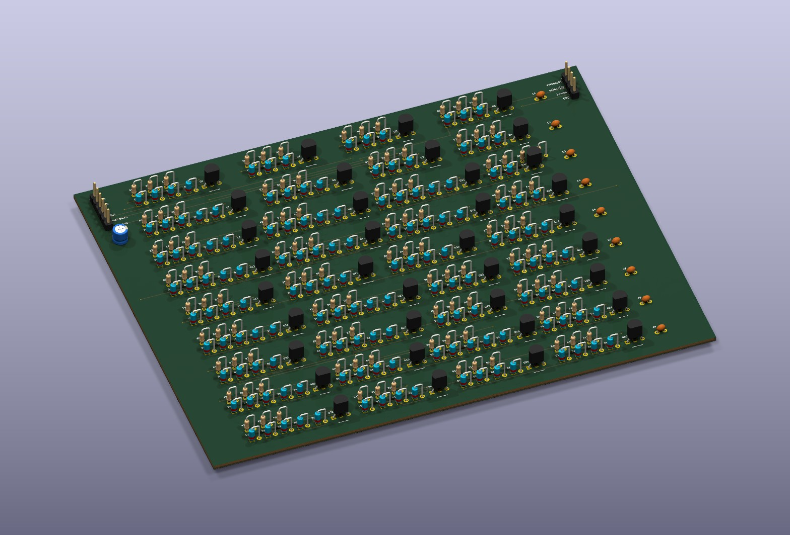
</p>

<p align="center">
  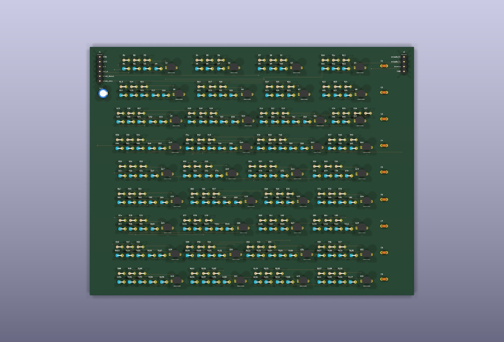
</p>

### Família de Válvulas Termiônicas a Vácuo (`--lib tube`)

Na família **tube** (1ª geração de computadores, estilo ENIAC / IBM 604), toda a lógica é construída com **válvulas subminiatura a vácuo Raytheon `JAN-6418`** (encapsulamento de vidro com 5 terminais em linha THT) e resistores (`RL = 10 kΩ` de placa e `R1 = 47 kΩ` de grade):

- **Células:** 19 (`2 DFFR`, `4 INV`, `4 NAND2`, `3 NOR2`, `3 NOR3`, `2 OR2`, `1 XOR2`)
- **Componentes:** 188 (**75 válvulas a vácuo `JAN-6418`** e 113 resistores — zero semicondutores!) + capacitores de desacoplamento
- **Dimensões:** 172 × 125 mm, 4 camadas, 8 fileiras
- **Roteamento e DRC:** 100 % roteada em 7 iterações (2 s), 0 violações de folga e 0 erros no DRC do KiCad

<p align="center">
  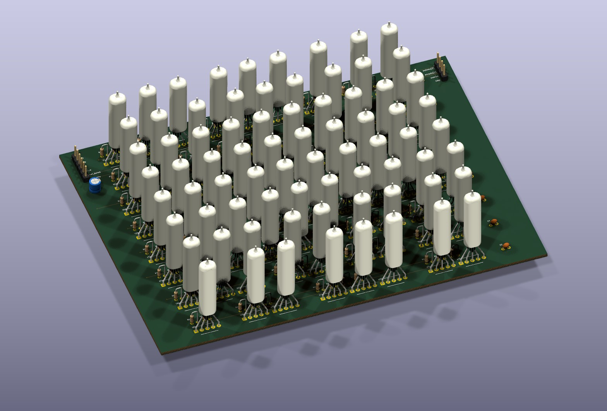
</p>

<p align="center">
  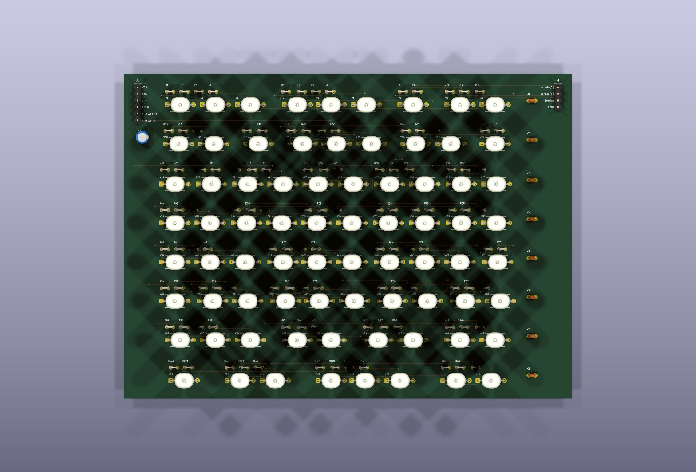
</p>

### Família CMOS Discreta (`--lib cmos`)

Na família **CMOS** discreta SMD, cada porta é construída com redes complementares pull-up (PMOS `BSS84`) e pull-down (NMOS `2N7002`) em encapsulamento SOT-23, sem resistores estáticos:

- **Células:** 21 (`2 DFFR`, `4 INV`, `4 NAND2`, `3 NAND3`, `1 NOR2`, `1 NOR3`, `6 OAI21`)
- **Componentes:** 152 (76 NMOS `2N7002` e 76 PMOS `BSS84`) + capacitores de desacoplamento SMD 0805
- **Dimensões:** 115 × 74 mm, 4 camadas, 5 fileiras
- **Roteamento e DRC:** 100 % roteada em 8 iterações (2 s), 0 violações de folga e 0 erros no DRC do KiCad

<p align="center">
  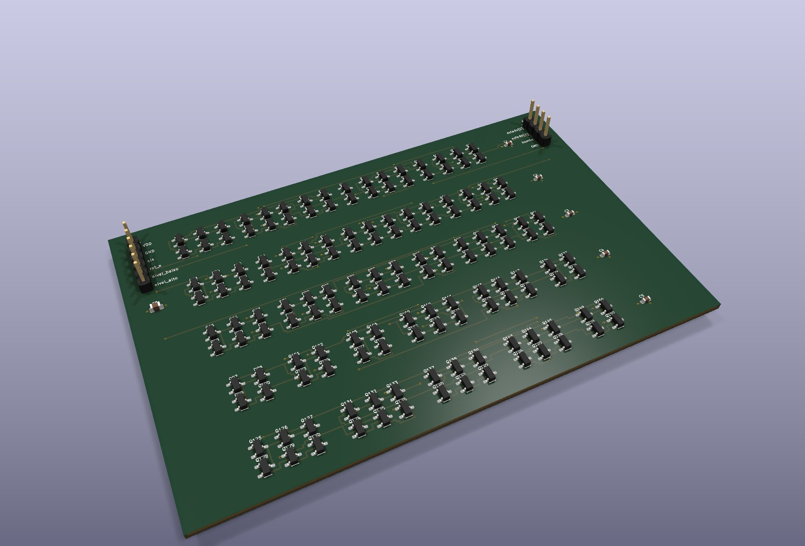
</p>

<p align="center">
  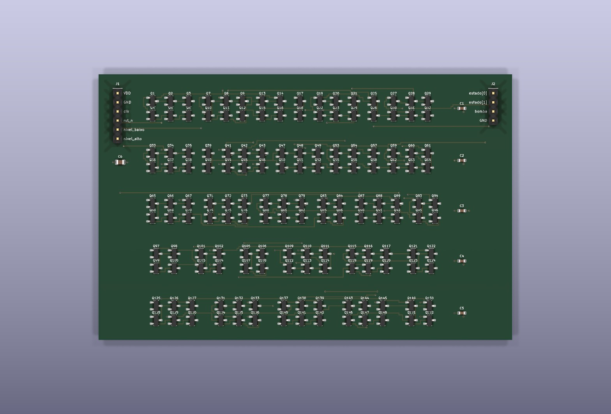
</p>

### Família de Relés Eletromecânicos (`--lib relay`)

Na família **relay** eletromecânica (geração Zuse Z3 / Harvard Mark II), cada célula usa relés SPDT de 5 V (`Omron G5V-1`) com diodos de roda-livre (`1N4148`), explorando o contato comutador SPDT para realizar `MUX2`, `XOR2` e `XNOR2` com apenas 1 relé:

- **Células:** 15 (`2 DFFR`, `3 INV`, `1 MUX2`, `5 NAND2`, `2 OR2`, `1 XNOR2`, `1 XOR2`)
- **Componentes:** 64 (34 relés SPDT `Omron G5V-1` e 30 diodos `1N4148`) + capacitores de desacoplamento
- **Dimensões:** 140 × 100 mm, 4 camadas, 5 fileiras
- **Roteamento e DRC:** 100 % roteada em 6 iterações (2 s), 0 violações de folga e 0 erros no DRC do KiCad

<p align="center">
  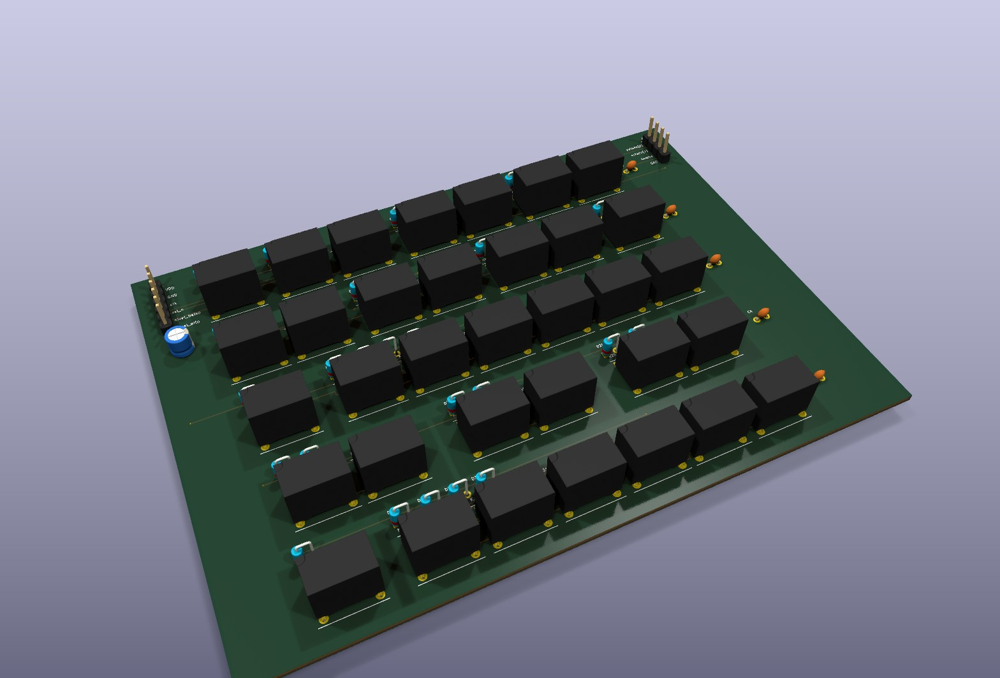
</p>

<p align="center">
  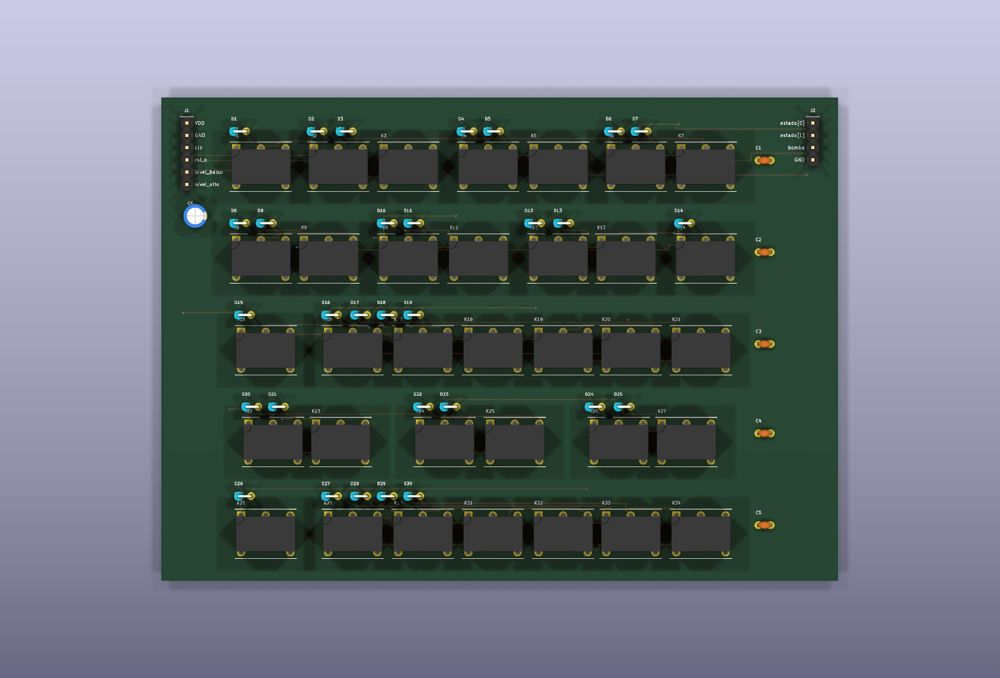
</p>

## Como gerar e simular

```sh
cd examples/tanque
pcbflow --top tanque --lib rtl                                    # gera a PCB na família RTL
pcbflow --top tanque --lib dtl                                    # gera a PCB na família DTL (diodos + NPN)
pcbflow --top tanque --lib ctl                                    # gera a PCB na família CTL (ferrite + NPN)
pcbflow --top tanque --lib cdl                                    # gera a PCB na família CDL (ferrite + diodos)
pcbflow --top tanque --lib tube                                   # gera a PCB na família de válvulas a vácuo (JAN-6418)
pcbflow --top tanque --lib cmos                                   # gera a PCB na família CMOS discreta (2N7002 + BSS84)
pcbflow --top tanque --lib relay                                  # gera a PCB na família de relés SPDT (Omron G5V-1)
pcbflow-cellsim --lib rtl --design tanque --src tanque.v          # simulação analógica SPICE nos 4 cantos (RTL)
pcbflow-cellsim --lib dtl --design tanque --src tanque.v          # simulação analógica SPICE nos 4 cantos (DTL)
pcbflow-cellsim --lib ctl --design tanque --src tanque.v          # simulação analógica SPICE nos 4 cantos (CTL)
pcbflow-cellsim --lib cdl --design tanque --src tanque.v          # simulação analógica SPICE nos 4 cantos (CDL)
pcbflow-cellsim --lib tube --design tanque --src tanque.v         # simulação analógica SPICE nos 4 cantos (válvulas)
pcbflow-cellsim --lib cmos --design tanque --src tanque.v         # simulação analógica SPICE nos 4 cantos (CMOS)
pcbflow-cellsim --lib relay --design tanque --src tanque.v        # simulação analógica SPICE nos 4 cantos (relés)
```
